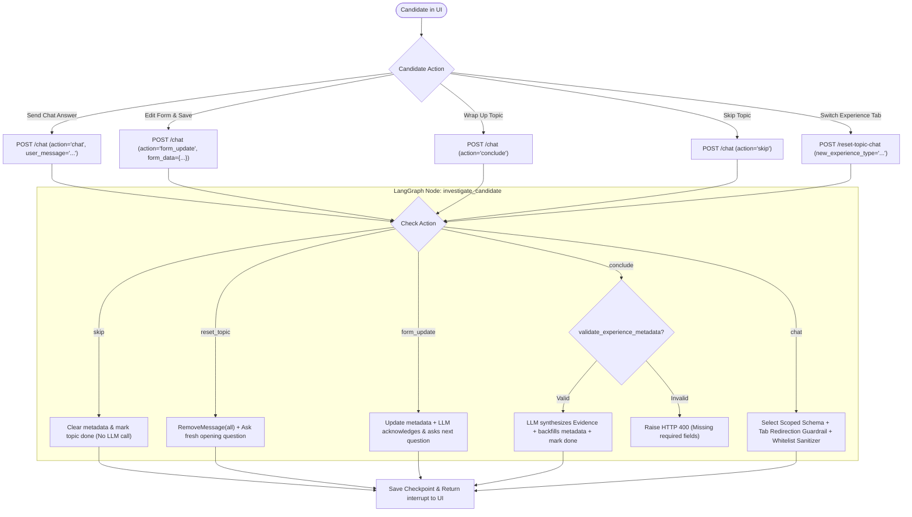

# Live Evidence Form & Experience Disambiguation: Backend Architecture & Code Walkthrough

This document provides a comprehensive, code-level explanation of the backend changes made to support the **Live Evidence Form**, **Single-Entity Experience Disambiguation**, **Scoped Category Schemas**, **Required Field Validation**, and **Atomic Context Clearing**.

---

## Table of Contents
1. [Core Problems & Architectural Objectives](#1-core-problems--architectural-objectives)
2. [End-to-End Execution Flows & Sequence Diagrams](#2-end-to-end-execution-flows--sequence-diagrams)
3. [File-by-File Code Comparison (Old vs. New) & Flow Rationale](#3-file-by-file-code-comparison-old-vs-new--flow-rationale)
   - [A. `backend/agent/model.py`](#a-backendagentmodelpy)
   - [B. `backend/agent/state.py`](#b-backendagentstatepy)
   - [C. `backend/agent/nodes/interview.py`](#c-backendagentnodesinterviewpy)
   - [D. `backend/agent/nodes/human_decision.py`](#d-backendagentnodeshumandecisionpy)
   - [E. `backend/agent/graph_service.py`](#e-backendagentgraphservicepy)
   - [F. `backend/api/resume.py`](#f-backendapiresumepy)
4. [LangGraph Checkpointer Mechanics & Edge Cases](#4-langgraph-checkpointer-mechanics--edge-cases)

---

## 1. Core Problems & Architectural Objectives

Prior to this implementation, the interview investigation loop suffered from four major issues:

1. **Experience Bleed & Cross-Type Data Contamination**:
   - If a candidate mentioned multiple experiences in chat (e.g. *"At Amazon I was President of the club and built a side project"*), an unconstrained monolithic schema allowed the LLM to populate `company`, `leadership_title`, and `project_name` simultaneously, leaking foreign keys into a single entry.
   - **Solution**: Split metadata into **4 tightly scoped Pydantic models** (`WorkExperienceMetadata`, `ProjectMetadata`, `LeadershipMetadata`, `OtherMetadata`). When investigating a Work Experience, OpenAI's JSON schema literally does not have fields for `project_name` or `leadership_title`.
2. **Missing Grounding / Identity Feedback**:
   - The candidate had no visual confirmation of what company or project the AI thought it was discussing until bullet generation occurred.
   - **Solution**: A real-time `active_experience_metadata` state channel streams structured identity fields (Company, Title, Dates, Location) to the frontend form on every turn.
3. **Stale Action & State Leakage Bug**:
   - When skipping Topic 1 (`human_investigate_action: "skip"`), selecting Topic 2 would inherit the stale `"skip"` action because `reset_investigation` previously only cleared message history and left action state intact. Topic 2 would auto-skip immediately without asking questions.
   - **Solution**: Explicitly reset `human_investigate_action = "chat"` and `active_experience_metadata = None` in `reset_investigation`.
4. **Premature Conclusion without Identity**:
   - A candidate could click "Wrap Up & Save Evidence" with empty or ambiguous entities.
   - **Solution**: Strict backend validation (`validate_experience_metadata`) that raises HTTP 400 if required fields are missing (`company` + `job_title` for Work; `project_name` + `role` for Project; `leadership_title` + `position` for Leadership; `other_title` for Other).

---

## 2. End-to-End Execution Flows & Sequence Diagrams

### High-Level Request Routing Flow



---

## 3. File-by-File Code Comparison (Old vs. New) & Flow Rationale

---

### A. [`backend/agent/model.py`](file:///D:/Documents/resume-agent/backend/agent/model.py)

#### 1. Code Snippet: Scoped Category Schemas & Whitelist Map

```python
# ==============================================================================
# OLD CODE
# ==============================================================================
class InvestigateOutput(BaseModel):
    need_more_info: SkipJsonSchema[bool] = True
    user_message: str = Field(description="Message to the user asking for more details/clarification or summarizing established experience")
    evidence: Evidence | None

# ==============================================================================
# NEW CODE
# ==============================================================================
class WorkExperienceMetadata(BaseModel):
    experience_type: Literal["work_experience"] = Field(default="work_experience")
    company: Optional[str] = Field(default=None, description="Company / employer name (REQUIRED).")
    job_title: Optional[str] = Field(default=None, description="Role or job title (REQUIRED).")
    duration: Optional[str] = Field(default=None, description="Timeframe or dates (e.g. 'June 2022 - Aug 2023').")
    location: Optional[str] = Field(default=None, description="Geographic location or 'Remote'.")

class ProjectMetadata(BaseModel):
    experience_type: Literal["project"] = Field(default="project")
    project_name: Optional[str] = Field(default=None, description="Name of the project (REQUIRED).")
    role: Optional[str] = Field(default=None, description="Candidate's role e.g. Creator, Lead (REQUIRED).")
    technologies: Optional[list[str]] = Field(default=None, description="Key technologies or tools explicitly mentioned.")
    duration: Optional[str] = Field(default=None, description="Timeframe or duration (e.g. '3 months', 'Fall 2023').")

class LeadershipMetadata(BaseModel):
    experience_type: Literal["leadership"] = Field(default="leadership")
    leadership_title: Optional[str] = Field(default=None, description="Organization or initiative name (REQUIRED).")
    position: Optional[str] = Field(default=None, description="Position held e.g. President (REQUIRED).")
    duration: Optional[str] = Field(default=None, description="Timeframe or dates.")
    location: Optional[str] = Field(default=None, description="Geographic location or 'Remote'.")

class OtherMetadata(BaseModel):
    experience_type: Literal["other"] = Field(default="other")
    other_title: Optional[str] = Field(default=None, description="Title of activity/experience (REQUIRED).")
    other_organization: Optional[str] = None
    other_role: Optional[str] = None
    other_notes: Optional[str] = None

class InitialExperienceMetadata(BaseModel):
    experience_type: Optional[Literal["work_experience", "project", "leadership", "other"]] = None
    company: Optional[str] = None
    job_title: Optional[str] = None
    project_name: Optional[str] = None
    role: Optional[str] = None
    leadership_title: Optional[str] = None
    position: Optional[str] = None
    other_title: Optional[str] = None
    duration: Optional[str] = None
    location: Optional[str] = None
    technologies: Optional[list[str]] = None

ExperienceMetadata = InitialExperienceMetadata

ALLOWED_KEYS_PER_TYPE = {
    "work_experience": {"experience_type", "company", "job_title", "duration", "location"},
    "project": {"experience_type", "project_name", "role", "technologies", "duration"},
    "leadership": {"experience_type", "leadership_title", "position", "duration", "location"},
    "other": {"experience_type", "other_title", "other_organization", "other_role", "other_notes"},
}

class WorkInvestigateOutput(BaseModel):
    need_more_info: SkipJsonSchema[bool] = True
    user_message: str = Field(description="Message to user asking for clarification.")
    experience_metadata: Optional[WorkExperienceMetadata] = None
    evidence: Evidence | None = None

class ProjectInvestigateOutput(BaseModel):
    need_more_info: SkipJsonSchema[bool] = True
    user_message: str = Field(description="Message to user asking for clarification.")
    experience_metadata: Optional[ProjectMetadata] = None
    evidence: Evidence | None = None

class LeadershipInvestigateOutput(BaseModel):
    need_more_info: SkipJsonSchema[bool] = True
    user_message: str = Field(description="Message to user asking for clarification.")
    experience_metadata: Optional[LeadershipMetadata] = None
    evidence: Evidence | None = None

class OtherInvestigateOutput(BaseModel):
    need_more_info: SkipJsonSchema[bool] = True
    user_message: str = Field(description="Message to user asking for clarification.")
    experience_metadata: Optional[OtherMetadata] = None
    evidence: Evidence | None = None

SCOPED_INVESTIGATE_OUTPUT_MAP = {
    "work_experience": WorkInvestigateOutput,
    "project": ProjectInvestigateOutput,
    "leadership": LeadershipInvestigateOutput,
    "other": OtherInvestigateOutput,
}
```

#### Why it Changed:
- A single "kitchen-sink" schema allowed the LLM to emit leadership fields or project fields even when exploring a corporate job.
- Splitting into 4 dedicated schemas guarantees that the JSON schema passed to OpenAI's structured outputs API **only contains fields relevant to that experience type**. Cross-contamination is blocked at the schema level.

---

### B. [`backend/agent/state.py`](file:///D:/Documents/resume-agent/backend/agent/state.py)

#### 1. Code Snippet: Adding `active_experience_metadata` Channel

```python
# ==============================================================================
# OLD CODE
# ==============================================================================
class AgentState(TypedDict):
    # ... other state keys ...
    iteration_loop: int

# ==============================================================================
# NEW CODE
# ==============================================================================
class AgentState(TypedDict):
    # ... other state keys ...
    iteration_loop: int
    active_experience_metadata: Optional[dict]
```

#### Why it Changed:
- Declares a persistent channel on `AgentState` so identity metadata survives across HTTP turn boundaries in the LangGraph checkpointer.

---

### C. [`backend/agent/nodes/interview.py`](file:///D:/Documents/resume-agent/backend/agent/nodes/interview.py)

#### 1. Code Snippet: Required Fields Validation

```python
# ==============================================================================
# NEW CODE
# ==============================================================================
def validate_experience_metadata(metadata: dict | None) -> tuple[bool, str]:
    if not metadata or not metadata.get("experience_type"):
        return False, "Please select an experience type (Work Experience, Project, Leadership, or Other) and fill in the required fields before saving evidence."
    
    exp_type = metadata.get("experience_type")
    if exp_type == "work_experience":
        if not metadata.get("company") or not str(metadata.get("company")).strip():
            return False, "Company Name is required for Work Experience."
        if not metadata.get("job_title") or not str(metadata.get("job_title")).strip():
            return False, "Job Title is required for Work Experience."
    elif exp_type == "project":
        if not metadata.get("project_name") or not str(metadata.get("project_name")).strip():
            return False, "Project Name is required for Project Experience."
        if not metadata.get("role") or not str(metadata.get("role")).strip():
            return False, "Your Role is required for Project Experience."
    elif exp_type == "leadership":
        if not metadata.get("leadership_title") or not str(metadata.get("leadership_title")).strip():
            return False, "Organization / Activity Title is required for Leadership."
        if not metadata.get("position") or not str(metadata.get("position")).strip():
            return False, "Position is required for Leadership."
    elif exp_type == "other":
        if not metadata.get("other_title") or not str(metadata.get("other_title")).strip():
            return False, "Experience Title is required for Other Experience."
    return True, ""
```

---

#### 2. Code Snippet: Dynamic Scoped Output, Tab Redirection Prompt & Whitelist Sanitization

```python
# ==============================================================================
# NEW CODE in investigate_candidate (action == "chat"):
# ==============================================================================
    active_type = active_metadata.get("experience_type")
    output_schema = SCOPED_INVESTIGATE_OUTPUT_MAP.get(active_type, InvestigateOutput)

    if active_type:
        type_display = active_type.replace("_", " ").title()
        entity_name = (
            active_metadata.get("company")
            or active_metadata.get("project_name")
            or active_metadata.get("leadership_title")
            or active_metadata.get("other_title")
            or f"this {type_display}"
        )
        scoping_instructions = f"""
### Category Focus & Tab Redirection:
- The current investigation is strictly focused on {type_display}: "{entity_name}".
- Keep all probing questions focused strictly on concrete actions, ownership, technologies, and metrics for this {type_display}.
- If the candidate mentions an experience belonging to a different category (e.g. they describe a personal project or student activity while this topic is focused on Work Experience), DO NOT combine them and DO NOT probe into that other category.
- Instead, politely acknowledge it and instruct the candidate that they can switch to the corresponding tab (Work Experience, Project, Leadership, or Other) on the right to focus on that experience instead.
- Populate `experience_metadata` ONLY with identity fields relevant to this {type_display}.
"""
    else:
        scoping_instructions = """
### Initial Experience Detection:
- The experience category for this requirement has not been determined yet.
- From the candidate's response, determine whether this experience is best categorized as 'work_experience', 'project', 'leadership', or 'other', and set experience_type accordingly in experience_metadata.
- Once determined, focus exclusively on that single experience.
"""

    # ... LLM invoke with output_schema ...

    # Merge newly detected metadata into active_metadata with strict whitelist sanitization
    merged_metadata = dict(active_metadata) if active_metadata else {}
    if response.experience_metadata:
        new_data = response.experience_metadata.model_dump(exclude_none=True)
        # If experience_type is already locked, prevent LLM from changing it mid-investigation
        if merged_metadata.get("experience_type"):
            new_data.pop("experience_type", None)
            current_type = merged_metadata["experience_type"]
        else:
            current_type = new_data.get("experience_type") or "work_experience"
            new_data["experience_type"] = current_type

        # Whitelist filter: discard any keys that do not belong to current_type
        allowed_keys = ALLOWED_KEYS_PER_TYPE.get(current_type, set())
        sanitized_data = {k: v for k, v in new_data.items() if k in allowed_keys}
        merged_metadata.update(sanitized_data)

    return {
        "investigation_messages": [AIMessage(content=response.user_message)],
        "need_more_info": True,
        "active_experience_metadata": merged_metadata or None,
    }
```

#### Why it Changed:
- **Dynamic Scoped Output**: Dynamically binds `WorkInvestigateOutput`, `ProjectInvestigateOutput`, `LeadershipInvestigateOutput`, or `OtherInvestigateOutput`.
- **The 4-Pillars Resume Evidence Framework**: Guides the candidate to gather evidence across (1) Problem/Scale, (2) Architecture/Actions, (3) Trade-offs/Critical Thinking, and (4) Measurable Impact/Metrics.
- **Anti-Tunneling / Breadth Guardrail**: Explicitly prevents the LLM from getting stuck in recursive micro-implementation rabbit holes (e.g. drilling down into routine Python standard library logging, package imports, or boilerplate syntax).
- **Natural, Non-Echo Persona**: Strictly bans robotic openings (`"You've mentioned...", "You described..."`) and replaces them with direct, engaging questions like a senior tech lead conducting a collaborative design discussion.
- **Conversational Tab Redirection**: If a user mentions an experience belonging to a different category, the AI acknowledges it and directs the user to the corresponding tab on the right.
- **Whitelist Key Sanitizer**: Prevents unexpected dictionary keys from ever entering `AgentState`.
- **Turn 1 Auto-Classification**: If a topic is new and unclassified, the LLM determines `experience_type` on turn 1 and locks it for all subsequent turns.

---

### D. [`backend/agent/nodes/human_decision.py`](file:///D:/Documents/resume-agent/backend/agent/nodes/human_decision.py)

#### 1. Code Snippet: Smart Pre-population & Interrupt Metadata

```python
# ==============================================================================
# NEW CODE
# ==============================================================================
def human_after_interview_planner(state: AgentState):
    decision = interrupt(...)
    if decision == "proceed":
        return {"proceed_to_tailor_resume": True}

    # Smart Pre-population: Check if selected topic links to an existing resume entry
    topic_id = decision
    prepopulated_metadata = None
    if plan and getattr(plan, "interview_plan", None):
        selected_topic = next((item for item in plan.interview_plan if item.topic_id == topic_id), None)
        if selected_topic and selected_topic.relevant_experience_from_resume and state.get("resume_data"):
            for ref in selected_topic.relevant_experience_from_resume:
                entries = getattr(state["resume_data"], ref.type, [])
                entry = next((e for e in entries if getattr(e, "entry_id", None) == ref.entry_id), None)
                if entry:
                    if ref.type == "work_experience":
                        prepopulated_metadata = {
                            "experience_type": "work_experience",
                            "company": getattr(entry, "company", None),
                            "job_title": getattr(entry, "job_title", None),
                            "duration": getattr(entry, "duration", None),
                            "location": getattr(entry, "location", None),
                        }
                    elif ref.type == "projects":
                        prepopulated_metadata = {
                            "experience_type": "project",
                            "project_name": getattr(entry, "project_name", None),
                            "role": getattr(entry, "role", None),
                            "duration": getattr(entry, "duration", None),
                            "technologies": getattr(entry, "technologies", None),
                        }
                    elif ref.type == "leadership":
                        prepopulated_metadata = {
                            "experience_type": "leadership",
                            "leadership_title": getattr(entry, "title", None),
                            "position": getattr(entry, "position", None),
                            "duration": getattr(entry, "duration", None),
                            "location": getattr(entry, "location", None),
                        }
                    break

    return {
        "topic_id_selection": decision,
        "proceed_to_tailor_resume": False,
        "human_investigate_action": "chat",
        "active_experience_metadata": prepopulated_metadata,
    }
```

---

### E. [`backend/agent/graph_service.py`](file:///D:/Documents/resume-agent/backend/agent/graph_service.py)

#### 1. Code Snippet: Resume Session & Clear Investigation Helper

```python
# ==============================================================================
# NEW CODE
# ==============================================================================
async def resume_tailoring_session(
    session_id: str,
    user_message: str = "",
    action: str | None = None,
    form_data: dict | None = None,
    request: Request = None,
):
    # ...
    if current_interrupt_type == "investigate_chat":
        resume_val = {
            "action": action or "chat",
            "message": user_message or "",
        }
        if form_data:
            resume_val["form_data"] = form_data

    # ... Command(resume=resume_val) ...

async def clear_active_topic_investigation(
    session_id: str,
    new_experience_type: str | None = None,
    request: Request = None,
):
    form_data = {"experience_type": new_experience_type} if new_experience_type else None
    return await resume_tailoring_session(
        session_id=session_id,
        user_message="",
        action="reset_topic",
        form_data=form_data,
        request=request,
    )
```

---

### F. [`backend/api/resume.py`](file:///D:/Documents/resume-agent/backend/api/resume.py)

#### 1. Code Snippet: `POST /chat` with `form_data` & `POST /reset-topic-chat`

```python
# ==============================================================================
# NEW CODE
# ==============================================================================
@router.post("/chat")
async def chat(
    session_id: str = Form(...),
    user_message: str = Form(""),
    action: Optional[str] = Form(None),
    form_data: Optional[str] = Form(None),
    request: Request = None,
    current_user: dict = Depends(get_current_user),
):
    # ... validates inputs & ownership ...
    parsed_form_data = None
    if form_data:
        try:
            parsed_form_data = json.loads(form_data)
        except Exception:
            raise HTTPException(status_code=400, detail="Invalid form_data JSON format")

    response = await resume_tailoring_session(
        session_id=session_id,
        user_message=user_message,
        action=action,
        form_data=parsed_form_data,
        request=request,
    )
    return {"message": "Chat message sent", "ai_response": response}

@router.post("/reset-topic-chat")
async def reset_topic_chat(
    session_id: str = Form(...),
    new_experience_type: Optional[str] = Form(None),
    request: Request = None,
    current_user: dict = Depends(get_current_user),
):
    await verify_session_ownership(session_id=session_id, user_id=current_user["id"])
    response = await clear_active_topic_investigation(
        session_id=session_id,
        new_experience_type=new_experience_type,
        request=request,
    )
    return {"message": "Topic chat reset successfully", "ai_response": response}
```

---

## 4. LangGraph Checkpointer Mechanics & Edge Cases

### A. How `RemoveMessage` Operates on LangGraph Channels
In [`AgentState`](file:///D:/Documents/resume-agent/backend/agent/state.py), the `investigation_messages` channel uses the `add_messages` reducer:
```python
investigation_messages: Annotated[Sequence[BaseMessage], add_messages]
```
Under LangGraph semantics:
- Returning an empty list `[]` is a **no-op** (it appends 0 messages, leaving old messages intact).
- To actually delete messages from SQLite/Postgres checkpointer storage, you must return a sequence of `RemoveMessage(id=msg.id)` operations:
```python
remove_ops = [RemoveMessage(id=m.id) for m in state.get("investigation_messages", []) if hasattr(m, "id")]
```
This is executed during `reset_investigation` and `action == "reset_topic"`.

### B. Concurrency & Session Locks
All mutating graph operations acquire `session_lock(session_id)` in [`resume_tailoring_session`](file:///D:/Documents/resume-agent/backend/agent/graph_service.py).
If a user clicks "Save Changes" on the form while an AI chat response is generating, the requests are serialized, preventing checkpointer race conditions and database locks.
