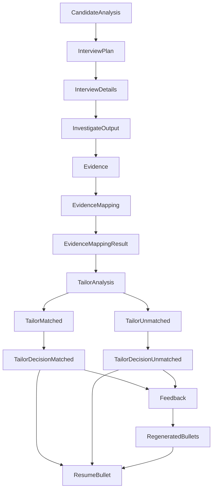

# Pydantic Model Architecture

Automatically generated from the application's Pydantic models.

## Model Pipeline



## Nested Model Structure

```mermaid
classDiagram

    class BulletFeedback {
        bool valid
        str suggestions
        int sentence_id
    }

    class CandidateAnalysis {
        Literal['weak match', 'good match', 'strong match'] score
        Optional[str] relevant_experience?
        Optional[list[CandidateStrength]] strengths?
        Optional[list[CandidateGap]] gaps?
        str user_message
    }

    class CandidateGap {
        str requirement
        Literal['missing', 'partial', 'unclear', 'transferable'] status
        Optional[list[str]] evidence?
        str gap
    }

    class CandidateStrength {
        str requirement
        list[str] evidence
        str explanation
    }

    class Evidence {
        Optional[Literal['work_experience', 'project', 'leadership', 'other']] experience_type?
        Optional[str] project_name?
        Optional[list[str]] experience_found?
        Optional[list[str]] technologies?
        Optional[list[str]] ownership?
        Optional[list[str]] scope?
        Optional[list[str]] metrics?
        Optional[list[str]] impact?
        Optional[list[str]] motivation?
        Optional[str] company?
        Optional[str] job_title?
        Optional[str] job_location?
        Optional[str] duration?
        Optional[str] leadership_title?
        Optional[str] leadership_position?
        Optional[str] other_title?
        Optional[list[str]] candidate_statements?
    }

    class EvidenceMapping {
        EvidenceWithDetails evidence_with_details
        Optional[ResumeReference] resume_reference?
        Literal['MATCHED', 'UNMATCHED'] mapping_status
        Optional[str] reasoning?
    }

    class EvidenceMappingResult {
        list[EvidenceMapping] evidence_mappings
    }

    class EvidenceWithDetails {
        Optional[Evidence] evidence?
        str job_requirement
        str topic_id
    }

    class Feedback {
        list[BulletFeedback] bullet_feedbacks
        str topic_id
    }

    class Feedbacks {
        list[Feedback] feedbacks
    }

    class InitialExperienceMetadata {
        Optional[Literal['work_experience', 'project', 'leadership', 'other']] experience_type?
        Optional[str] company?
        Optional[str] job_title?
        Optional[str] project_name?
        Optional[str] role?
        Optional[str] leadership_title?
        Optional[str] position?
        Optional[str] other_title?
        Optional[str] other_organization?
        Optional[str] other_role?
        Optional[str] other_notes?
        Optional[str] duration?
        Optional[str] location?
        Optional[list[str]] technologies?
    }

    class InterviewDetails {
        str topic_id
        Literal['Low', 'Medium', 'High'] priority
        Literal['skill_gap', 'metric_enrichment'] probe_type
        str topic
        str job_requirement
        str reason
        str objective
        Optional[list[str]] target_metrics?
        list[str] relevant_experience
        Optional[list[ResumeReference]] relevant_experience_from_resume?
        str evidence_gap
    }

    class InterviewPlan {
        list[InterviewDetails] interview_plan
    }

    class InvestigateOutput {
        bool need_more_info
        Optional[list[str]] already_established_facts?
        Optional[list[str]] unresolved_target_points?
        bool is_sufficient
        Optional[Literal['work_experience', 'project', 'leadership', 'other']] suggested_experience_tab?
        Optional[Evidence] evidence?
        str user_message
        Optional[InitialExperienceMetadata] experience_metadata?
    }

    class RegeneratedBullets {
        str topic_id
        list[ResumeBullet] new_bullet_points
        str reasoning
    }

    class RegeneratedBulletsList {
        list[RegeneratedBullets] regenerated_bullet_list
    }

    class ResumeBullet {
        str text
        int sentence_id
    }

    class ResumeReference {
        Literal['projects', 'work_experience', 'leadership'] type
        int entry_id
    }

    class TailorAnalysis {
        list[TailorMatched] tailor_matched_list
        list[TailorUnmatched] tailor_unmatched_list
    }

    class TailorDecisionMatched {
        Literal['KEEP', 'MODIFY', 'ADD'] action
        Optional[ResumeBullet] old_bullet?
        Optional[ResumeBullet] new_bullet?
        str reasoning
        list[str] evidence
    }

    class TailorDecisionUnmatched {
        Literal['ADD'] action
        NoneType old_bullet
        ResumeBullet new_bullet
        str reasoning
        list[str] evidence
    }

    class TailorMatched {
        list[TailorDecisionMatched] decisions
        ResumeReference resume_reference
        str topic_id
    }

    class TailorUnmatched {
        list[TailorDecisionUnmatched] decisions
        Literal['leadership', 'work_experience', 'projects'] type
        Optional[str] company_name?
        Optional[str] duration?
        Optional[str] job_location?
        Optional[str] job_title?
        Optional[list[str]] skills?
        Optional[str] project_name?
        str topic_id
        Optional[str] leadership_position?
        Optional[str] leadership_title?
    }

    CandidateAnalysis --> CandidateGap : gaps
    CandidateAnalysis --> CandidateStrength : strengths
    EvidenceMapping --> EvidenceWithDetails : evidence_with_details
    EvidenceMapping --> ResumeReference : resume_reference
    EvidenceMappingResult "1" --> "*" EvidenceMapping : evidence_mappings
    EvidenceWithDetails --> Evidence : evidence
    Feedback "1" --> "*" BulletFeedback : bullet_feedbacks
    Feedbacks "1" --> "*" Feedback : feedbacks
    InterviewDetails --> ResumeReference : relevant_experience_from_resume
    InterviewPlan "1" --> "*" InterviewDetails : interview_plan
    InvestigateOutput --> Evidence : evidence
    InvestigateOutput --> InitialExperienceMetadata : experience_metadata
    RegeneratedBullets "1" --> "*" ResumeBullet : new_bullet_points
    RegeneratedBulletsList "1" --> "*" RegeneratedBullets : regenerated_bullet_list
    TailorAnalysis "1" --> "*" TailorMatched : tailor_matched_list
    TailorAnalysis "1" --> "*" TailorUnmatched : tailor_unmatched_list
    TailorDecisionMatched --> ResumeBullet : new_bullet
    TailorDecisionMatched --> ResumeBullet : old_bullet
    TailorDecisionUnmatched --> ResumeBullet : new_bullet
    TailorMatched "1" --> "*" TailorDecisionMatched : decisions
    TailorMatched --> ResumeReference : resume_reference
    TailorUnmatched "1" --> "*" TailorDecisionUnmatched : decisions
```



## Field Reference

# Pydantic Model Field Reference

> Automatically generated from the Pydantic models.

## `BulletFeedback`

| Field | Type | Required | Default |
|---|---|---|---|
| `valid` | `bool` | Yes | `PydanticUndefined` |
| `suggestions` | `str` | Yes | `PydanticUndefined` |
| `sentence_id` | `int` | Yes | `PydanticUndefined` |

**`valid`:** Whether the proposed bullet is factually supported by the candidate's evidence.

**`suggestions`:** If invalid, identify the specific claim that is unsupported or missing evidence, state that the claim must be removed or corrected, and explain which evidence limitation makes it inaccurate. If valid, state that no factual correction is required.

## `CandidateAnalysis`

| Field | Type | Required | Default |
|---|---|---|---|
| `score` | `Literal['weak match', 'good match', 'strong match']` | Yes | `PydanticUndefined` |
| `relevant_experience` | `Optional[str]` | Yes | `PydanticUndefined` |
| `strengths` | `Optional[list[CandidateStrength]]` | Yes | `PydanticUndefined` |
| `gaps` | `Optional[list[CandidateGap]]` | Yes | `PydanticUndefined` |
| `user_message` | `str` | Yes | `PydanticUndefined` |

## `CandidateGap`

| Field | Type | Required | Default |
|---|---|---|---|
| `requirement` | `str` | Yes | `PydanticUndefined` |
| `status` | `Literal['missing', 'partial', 'unclear', 'transferable']` | Yes | `PydanticUndefined` |
| `evidence` | `Optional[list[str]]` | Yes | `PydanticUndefined` |
| `gap` | `str` | Yes | `PydanticUndefined` |

## `CandidateStrength`

| Field | Type | Required | Default |
|---|---|---|---|
| `requirement` | `str` | Yes | `PydanticUndefined` |
| `evidence` | `list[str]` | Yes | `PydanticUndefined` |
| `explanation` | `str` | Yes | `PydanticUndefined` |

## `Evidence`

| Field | Type | Required | Default |
|---|---|---|---|
| `experience_type` | `Optional[Literal['work_experience', 'project', 'leadership', 'other']]` | No | `None` |
| `project_name` | `Optional[str]` | No | `None` |
| `experience_found` | `Optional[list[str]]` | No | `None` |
| `technologies` | `Optional[list[str]]` | No | `None` |
| `ownership` | `Optional[list[str]]` | No | `None` |
| `scope` | `Optional[list[str]]` | No | `None` |
| `metrics` | `Optional[list[str]]` | No | `None` |
| `impact` | `Optional[list[str]]` | No | `None` |
| `motivation` | `Optional[list[str]]` | No | `None` |
| `company` | `Optional[str]` | No | `None` |
| `job_title` | `Optional[str]` | No | `None` |
| `job_location` | `Optional[str]` | No | `None` |
| `duration` | `Optional[str]` | No | `None` |
| `leadership_title` | `Optional[str]` | No | `None` |
| `leadership_position` | `Optional[str]` | No | `None` |
| `other_title` | `Optional[str]` | No | `None` |
| `candidate_statements` | `Optional[list[str]]` | No | `None` |

**`experience_type`:** The type of experience: 'work_experience', 'project', 'leadership', or 'other'.

**`project_name`:** Name of the project or experience, if applicable. If the candidate does not provide a name, create a concise name using only established context.

**`experience_found`:** Concrete experiences, actions, responsibilities, or accomplishments discovered during the interview.

**`technologies`:** Technologies, tools, frameworks, languages, or technical methods explicitly mentioned by the candidate.

**`ownership`:** What the candidate personally owned, initiated, designed, implemented, or was responsible for.

**`scope`:** Concrete scale or context of the work, such as users, teams, systems, programs, workload, or responsibilities.

**`metrics`:** Quantitative evidence explicitly provided by the candidate. Never infer, estimate, or manufacture metrics.

**`impact`:** Concrete outcomes or changes resulting from the candidate's work, using only evidence established by the candidate.

**`motivation`:** Candidate-stated motivations, reasons, interests, or decisions that explain why they pursued or cared about the experience.

**`candidate_statements`:** Original statements from the candidate that directly support the extracted evidence. Preserve the candidate's wording without adding interpretation or unsupported details.

## `EvidenceMapping`

| Field | Type | Required | Default |
|---|---|---|---|
| `evidence_with_details` | `EvidenceWithDetails` | Yes | `PydanticUndefined` |
| `resume_reference` | `Optional[ResumeReference]` | No | `(None, FieldInfo(annotation=NoneType, required=True, description='Reference to the specific resume entry that supports the evidence. If no matching resume entry is found, this field will be None.'))` |
| `mapping_status` | `Literal['MATCHED', 'UNMATCHED']` | Yes | `PydanticUndefined` |
| `reasoning` | `Optional[str]` | No | `None` |

**`mapping_status`:** MATCHED if there is a reference to the specific resume entry that supports the evidence.; otherwise UNMATCHED.

## `EvidenceMappingResult`

| Field | Type | Required | Default |
|---|---|---|---|
| `evidence_mappings` | `list[EvidenceMapping]` | Yes | `PydanticUndefined` |

## `EvidenceWithDetails`

| Field | Type | Required | Default |
|---|---|---|---|
| `evidence` | `Optional[Evidence]` | Yes | `PydanticUndefined` |
| `job_requirement` | `str` | Yes | `PydanticUndefined` |
| `topic_id` | `str` | Yes | `PydanticUndefined` |

**`evidence`:** Evidence found in the candidate's resume or profile data that supports their experience and qualifications for the job requirements. If no evidence is found, this field will be None

## `Feedback`

| Field | Type | Required | Default |
|---|---|---|---|
| `bullet_feedbacks` | `list[BulletFeedback]` | Yes | `PydanticUndefined` |
| `topic_id` | `str` | No | `None` |

## `Feedbacks`

| Field | Type | Required | Default |
|---|---|---|---|
| `feedbacks` | `list[Feedback]` | Yes | `PydanticUndefined` |

## `InitialExperienceMetadata`

| Field | Type | Required | Default |
|---|---|---|---|
| `experience_type` | `Optional[Literal['work_experience', 'project', 'leadership', 'other']]` | No | `None` |
| `company` | `Optional[str]` | No | `None` |
| `job_title` | `Optional[str]` | No | `None` |
| `project_name` | `Optional[str]` | No | `None` |
| `role` | `Optional[str]` | No | `None` |
| `leadership_title` | `Optional[str]` | No | `None` |
| `position` | `Optional[str]` | No | `None` |
| `other_title` | `Optional[str]` | No | `None` |
| `other_organization` | `Optional[str]` | No | `None` |
| `other_role` | `Optional[str]` | No | `None` |
| `other_notes` | `Optional[str]` | No | `None` |
| `duration` | `Optional[str]` | No | `None` |
| `location` | `Optional[str]` | No | `None` |
| `technologies` | `Optional[list[str]]` | No | `None` |

**`experience_type`:** The category of the single experience being explored: 'work_experience', 'project', 'leadership', or 'other'.

**`company`:** Company / employer name (if work_experience).

**`job_title`:** Role or job title (if work_experience).

**`project_name`:** Name of the project (if project).

**`role`:** Candidate's role in the project e.g. Lead Developer, Creator (if project).

**`leadership_title`:** Organization, club, or initiative name (if leadership).

**`position`:** Position held e.g. President, Chair (if leadership).

**`other_title`:** Title or concise name of the activity/experience (if other).

**`duration`:** Timeframe or dates (e.g. 'June 2022 - Aug 2023', '2024').

**`location`:** Geographic location or 'Remote'.

**`technologies`:** Key technologies or tools explicitly mentioned for this experience.

## `InterviewDetails`

| Field | Type | Required | Default |
|---|---|---|---|
| `topic_id` | `str` | Yes | `PydanticUndefined` |
| `priority` | `Literal['Low', 'Medium', 'High']` | Yes | `PydanticUndefined` |
| `probe_type` | `Literal['skill_gap', 'metric_enrichment']` | No | `skill_gap` |
| `topic` | `str` | Yes | `PydanticUndefined` |
| `job_requirement` | `str` | Yes | `PydanticUndefined` |
| `reason` | `str` | Yes | `PydanticUndefined` |
| `objective` | `str` | Yes | `PydanticUndefined` |
| `target_metrics` | `Optional[list[str]]` | No | `None` |
| `relevant_experience` | `list[str]` | Yes | `PydanticUndefined` |
| `relevant_experience_from_resume` | `Optional[list[ResumeReference]]` | Yes | `PydanticUndefined` |
| `evidence_gap` | `str` | Yes | `PydanticUndefined` |

**`topic_id`:** Unique identifier for topic

**`probe_type`:** 'skill_gap' when investigating unproven technical requirements; 'metric_enrichment' when the candidate already has the required experience, but their resume bullets are purely qualitative and need quantifiable scale, users, or performance metrics.

**`topic`:** Concise name for the specific investigation target (e.g. 'Study Group App: User Scale & API Latency').

**`job_requirement`:** The relevant job requirement exactly as stated or faithfully represented.

**`reason`:** Why this requirement warrants investigation for this candidate. For metric_enrichment, explain that the candidate demonstrated the core work but lacks quantifiable scale, user adoption, throughput, or latency metrics.

**`objective`:** What the investigation should establish. For metric_enrichment, define the specific metric targets needed to turn qualitative descriptions into high-impact Google XYZ bullet points.

**`target_metrics`:** If probe_type is 'metric_enrichment', list the specific metrics to discover (e.g. ['student user count', 'active study groups', 'API response latency', 'cloud uptime']). None if probe_type is 'skill_gap'.

**`relevant_experience`:** Candidate experiences relevant or potentially relevant to the investigation. Keep experiences distinct and do not merge experiences from different sections.

**`relevant_experience_from_resume`:** References to complete resume entries relevant to this topic. Each reference identifies an entry by type and entry_id. Return None if no relevant resume entries exist.

**`evidence_gap`:** The specific important fact, evidence, or unquantified metric dimension that is currently unknown or weak. This should describe what the interview needs to uncover, not merely repeat the job requirement.

## `InterviewPlan`

| Field | Type | Required | Default |
|---|---|---|---|
| `interview_plan` | `list[InterviewDetails]` | Yes | `PydanticUndefined` |

## `InvestigateOutput`

| Field | Type | Required | Default |
|---|---|---|---|
| `need_more_info` | `bool` | No | `True` |
| `already_established_facts` | `Optional[list[str]]` | No | `None` |
| `unresolved_target_points` | `Optional[list[str]]` | No | `PydanticUndefined` |
| `is_sufficient` | `bool` | No | `False` |
| `suggested_experience_tab` | `Optional[Literal['work_experience', 'project', 'leadership', 'other']]` | No | `None` |
| `evidence` | `Optional[Evidence]` | No | `None` |
| `user_message` | `str` | Yes | `PydanticUndefined` |
| `experience_metadata` | `Optional[InitialExperienceMetadata]` | No | `None` |

**`already_established_facts`:** List any technologies, tools, cloud platforms, roles, or metrics mentioned in the target objective that are ALREADY verified in the Established Evidence Bank across any candidate experience. If none, return empty list.

**`unresolved_target_points`:** List ONLY the remaining unknown elements from the target objective that still need to be probed (e.g. ['Number of student users or active study groups']). NEVER include anything listed in already_established_facts.

**`is_sufficient`:** Set to True ONLY when the candidate has demonstrated concrete actions for the target requirement, AND either applicable metrics/scale were gathered (or already known in the evidence bank), or the candidate confirmed they were not tracked or not applicable. MUST be False if key actions are missing or if applicable metrics have not yet been probed.

**`suggested_experience_tab`:** If the candidate indicates that the probed skill/requirement was gained or applied in a different experience category (e.g. in an internship or job -> 'work_experience', personal or academic project -> 'project', club or leadership initiative -> 'leadership', other -> 'other'), specify that category here. Otherwise None.

**`user_message`:** Conversational response to the candidate adhering to the 4 Turn States: 1. If is_sufficient is True: DO NOT ask any more questions. Warmly and concisely summarize the strong evidence gathered and invite them to click 'Wrap Up & Save Evidence'. 2. If suggested_experience_tab is set: warmly acknowledge where the skill was gained and explicitly instruct them to switch to that tab on the right so it can be captured accurately; DO NOT confirm as proceed or invite wrap-up. 3. If candidate confirms no experience with this requirement anywhere: politely acknowledge, reassure them, and suggest using 'Skip Topic' to proceed. 4. Otherwise: ask the single next high-leverage probing question addressing ONLY unresolved_target_points. Acknowledge already_established_facts naturally if helpful, but NEVER re-ask details that are already established.

**`experience_metadata`:** High-level identity of the single experience being discussed. If candidate discusses multiple experiences, pick the most relevant one and do not merge.

## `RegeneratedBullets`

| Field | Type | Required | Default |
|---|---|---|---|
| `topic_id` | `str` | Yes | `PydanticUndefined` |
| `new_bullet_points` | `list[ResumeBullet]` | Yes | `PydanticUndefined` |
| `reasoning` | `str` | Yes | `PydanticUndefined` |

**`topic_id`:** Copy the topic_id from the corresponding input exactly. Never modify, generate, or invent a topic_id.

**`new_bullet_points`:** New bulletpoint points, utilizing XYZ format, accomplished X, as measured by Y, by doing Z, if enough details is present such as metrics/impact. Ensure bullet points created are aligned with job requirement. Do not invent metrics or details if not present

## `RegeneratedBulletsList`

| Field | Type | Required | Default |
|---|---|---|---|
| `regenerated_bullet_list` | `list[RegeneratedBullets]` | Yes | `PydanticUndefined` |

## `ResumeBullet`

| Field | Type | Required | Default |
|---|---|---|---|
| `text` | `str` | Yes | `PydanticUndefined` |
| `sentence_id` | `int` | Yes | `PydanticUndefined` |

## `ResumeReference`

| Field | Type | Required | Default |
|---|---|---|---|
| `type` | `Literal['projects', 'work_experience', 'leadership']` | Yes | `PydanticUndefined` |
| `entry_id` | `int` | Yes | `PydanticUndefined` |

**`entry_id`:** The entry_id of the resume entry being referenced.

## `TailorAnalysis`

| Field | Type | Required | Default |
|---|---|---|---|
| `tailor_matched_list` | `list[TailorMatched]` | No | `[]` |
| `tailor_unmatched_list` | `list[TailorUnmatched]` | No | `[]` |

## `TailorDecisionMatched`

| Field | Type | Required | Default |
|---|---|---|---|
| `action` | `Literal['KEEP', 'MODIFY', 'ADD']` | Yes | `PydanticUndefined` |
| `old_bullet` | `Optional[ResumeBullet]` | Yes | `PydanticUndefined` |
| `new_bullet` | `Optional[ResumeBullet]` | Yes | `PydanticUndefined` |
| `reasoning` | `str` | Yes | `PydanticUndefined` |
| `evidence` | `list[str]` | Yes | `PydanticUndefined` |

**`new_bullet`:** New bulletpoint points, utilizing XYZ format, accomplished X, as measured by Y, by doing Z, if enough details is present such as metrics/impact. Ensure bullet points created are aligned with job requirement. Do not invent metrics or details if not present

## `TailorDecisionUnmatched`

| Field | Type | Required | Default |
|---|---|---|---|
| `action` | `Literal['ADD']` | Yes | `PydanticUndefined` |
| `old_bullet` | `NoneType` | No | `None` |
| `new_bullet` | `ResumeBullet` | Yes | `PydanticUndefined` |
| `reasoning` | `str` | Yes | `PydanticUndefined` |
| `evidence` | `list[str]` | Yes | `PydanticUndefined` |

**`new_bullet`:** New bulletpoint points, utilizing XYZ format, accomplished X, as measured by Y, by doing Z, if enough details is present such as metrics/impact. Ensure bullet points created are aligned with job requirement. Do not invent metrics or details if not present

## `TailorMatched`

| Field | Type | Required | Default |
|---|---|---|---|
| `decisions` | `list[TailorDecisionMatched]` | Yes | `PydanticUndefined` |
| `resume_reference` | `ResumeReference` | Yes | `PydanticUndefined` |
| `topic_id` | `str` | Yes | `PydanticUndefined` |

**`resume_reference`:** Reference to the specific resume entry)

**`topic_id`:** Copy the topic_id from the corresponding input exactly. Never modify, generate, or invent a topic_id.

## `TailorUnmatched`

| Field | Type | Required | Default |
|---|---|---|---|
| `decisions` | `list[TailorDecisionUnmatched]` | Yes | `PydanticUndefined` |
| `type` | `Literal['leadership', 'work_experience', 'projects']` | Yes | `PydanticUndefined` |
| `company_name` | `Optional[str]` | No | `None` |
| `duration` | `Optional[str]` | No | `None` |
| `job_location` | `Optional[str]` | No | `None` |
| `job_title` | `Optional[str]` | No | `None` |
| `skills` | `Optional[list[str]]` | No | `None` |
| `project_name` | `Optional[str]` | No | `None` |
| `topic_id` | `str` | Yes | `PydanticUndefined` |
| `leadership_position` | `Optional[str]` | No | `None` |
| `leadership_title` | `Optional[str]` | No | `None` |

**`company_name`:** Company name if experience learned from work. Otherwise return None

**`duration`:** Duration of work experience if provided. Example: Dec 2024 - Present

**`job_title`:** Job title at company if experienced learned from work. Otherwise return None

**`skills`:** List of technologies or skills that was used from the experience

**`project_name`:** Project name where experience was learned. Return None if experience was learned from work

**`topic_id`:** Copy the topic_id from the corresponding input exactly. Never modify, generate, or invent a topic_id.


## Raw JSON Schema

```json
{
  "BulletFeedback": {
    "properties": {
      "valid": {
        "description": "Whether the proposed bullet is factually supported by the candidate's evidence.",
        "title": "Valid",
        "type": "boolean"
      },
      "suggestions": {
        "description": "If invalid, identify the specific claim that is unsupported or missing evidence, state that the claim must be removed or corrected, and explain which evidence limitation makes it inaccurate. If valid, state that no factual correction is required.",
        "title": "Suggestions",
        "type": "string"
      },
      "sentence_id": {
        "title": "Sentence Id",
        "type": "integer"
      }
    },
    "required": [
      "valid",
      "suggestions",
      "sentence_id"
    ],
    "title": "BulletFeedback",
    "type": "object"
  },
  "CandidateAnalysis": {
    "$defs": {
      "CandidateGap": {
        "properties": {
          "requirement": {
            "title": "Requirement",
            "type": "string"
          },
          "status": {
            "enum": [
              "missing",
              "partial",
              "unclear",
              "transferable"
            ],
            "title": "Status",
            "type": "string"
          },
          "evidence": {
            "anyOf": [
              {
                "items": {
                  "type": "string"
                },
                "type": "array"
              },
              {
                "type": "null"
              }
            ],
            "title": "Evidence"
          },
          "gap": {
            "title": "Gap",
            "type": "string"
          }
        },
        "required": [
          "requirement",
          "status",
          "evidence",
          "gap"
        ],
        "title": "CandidateGap",
        "type": "object"
      },
      "CandidateStrength": {
        "properties": {
          "requirement": {
            "title": "Requirement",
            "type": "string"
          },
          "evidence": {
            "items": {
              "type": "string"
            },
            "title": "Evidence",
            "type": "array"
          },
          "explanation": {
            "title": "Explanation",
            "type": "string"
          }
        },
        "required": [
          "requirement",
          "evidence",
          "explanation"
        ],
        "title": "CandidateStrength",
        "type": "object"
      }
    },
    "properties": {
      "score": {
        "enum": [
          "weak match",
          "good match",
          "strong match"
        ],
        "title": "Score",
        "type": "string"
      },
      "relevant_experience": {
        "anyOf": [
          {
            "type": "string"
          },
          {
            "type": "null"
          }
        ],
        "title": "Relevant Experience"
      },
      "strengths": {
        "anyOf": [
          {
            "items": {
              "$ref": "#/$defs/CandidateStrength"
            },
            "type": "array"
          },
          {
            "type": "null"
          }
        ],
        "title": "Strengths"
      },
      "gaps": {
        "anyOf": [
          {
            "items": {
              "$ref": "#/$defs/CandidateGap"
            },
            "type": "array"
          },
          {
            "type": "null"
          }
        ],
        "title": "Gaps"
      },
      "user_message": {
        "title": "User Message",
        "type": "string"
      }
    },
    "required": [
      "score",
      "relevant_experience",
      "strengths",
      "gaps",
      "user_message"
    ],
    "title": "CandidateAnalysis",
    "type": "object"
  },
  "CandidateGap": {
    "properties": {
      "requirement": {
        "title": "Requirement",
        "type": "string"
      },
      "status": {
        "enum": [
          "missing",
          "partial",
          "unclear",
          "transferable"
        ],
        "title": "Status",
        "type": "string"
      },
      "evidence": {
        "anyOf": [
          {
            "items": {
              "type": "string"
            },
            "type": "array"
          },
          {
            "type": "null"
          }
        ],
        "title": "Evidence"
      },
      "gap": {
        "title": "Gap",
        "type": "string"
      }
    },
    "required": [
      "requirement",
      "status",
      "evidence",
      "gap"
    ],
    "title": "CandidateGap",
    "type": "object"
  },
  "CandidateStrength": {
    "properties": {
      "requirement": {
        "title": "Requirement",
        "type": "string"
      },
      "evidence": {
        "items": {
          "type": "string"
        },
        "title": "Evidence",
        "type": "array"
      },
      "explanation": {
        "title": "Explanation",
        "type": "string"
      }
    },
    "required": [
      "requirement",
      "evidence",
      "explanation"
    ],
    "title": "CandidateStrength",
    "type": "object"
  },
  "Evidence": {
    "properties": {
      "experience_type": {
        "anyOf": [
          {
            "enum": [
              "work_experience",
              "project",
              "leadership",
              "other"
            ],
            "type": "string"
          },
          {
            "type": "null"
          }
        ],
        "default": null,
        "description": "The type of experience: 'work_experience', 'project', 'leadership', or 'other'.",
        "title": "Experience Type"
      },
      "project_name": {
        "anyOf": [
          {
            "type": "string"
          },
          {
            "type": "null"
          }
        ],
        "default": null,
        "description": "Name of the project or experience, if applicable. If the candidate does not provide a name, create a concise name using only established context.",
        "title": "Project Name"
      },
      "experience_found": {
        "anyOf": [
          {
            "items": {
              "type": "string"
            },
            "type": "array"
          },
          {
            "type": "null"
          }
        ],
        "default": null,
        "description": "Concrete experiences, actions, responsibilities, or accomplishments discovered during the interview.",
        "title": "Experience Found"
      },
      "technologies": {
        "anyOf": [
          {
            "items": {
              "type": "string"
            },
            "type": "array"
          },
          {
            "type": "null"
          }
        ],
        "default": null,
        "description": "Technologies, tools, frameworks, languages, or technical methods explicitly mentioned by the candidate.",
        "title": "Technologies"
      },
      "ownership": {
        "anyOf": [
          {
            "items": {
              "type": "string"
            },
            "type": "array"
          },
          {
            "type": "null"
          }
        ],
        "default": null,
        "description": "What the candidate personally owned, initiated, designed, implemented, or was responsible for.",
        "title": "Ownership"
      },
      "scope": {
        "anyOf": [
          {
            "items": {
              "type": "string"
            },
            "type": "array"
          },
          {
            "type": "null"
          }
        ],
        "default": null,
        "description": "Concrete scale or context of the work, such as users, teams, systems, programs, workload, or responsibilities.",
        "title": "Scope"
      },
      "metrics": {
        "anyOf": [
          {
            "items": {
              "type": "string"
            },
            "type": "array"
          },
          {
            "type": "null"
          }
        ],
        "default": null,
        "description": "Quantitative evidence explicitly provided by the candidate. Never infer, estimate, or manufacture metrics.",
        "title": "Metrics"
      },
      "impact": {
        "anyOf": [
          {
            "items": {
              "type": "string"
            },
            "type": "array"
          },
          {
            "type": "null"
          }
        ],
        "default": null,
        "description": "Concrete outcomes or changes resulting from the candidate's work, using only evidence established by the candidate.",
        "title": "Impact"
      },
      "motivation": {
        "anyOf": [
          {
            "items": {
              "type": "string"
            },
            "type": "array"
          },
          {
            "type": "null"
          }
        ],
        "default": null,
        "description": "Candidate-stated motivations, reasons, interests, or decisions that explain why they pursued or cared about the experience.",
        "title": "Motivation"
      },
      "company": {
        "anyOf": [
          {
            "type": "string"
          },
          {
            "type": "null"
          }
        ],
        "default": null,
        "title": "Company"
      },
      "job_title": {
        "anyOf": [
          {
            "type": "string"
          },
          {
            "type": "null"
          }
        ],
        "default": null,
        "title": "Job Title"
      },
      "job_location": {
        "anyOf": [
          {
            "type": "string"
          },
          {
            "type": "null"
          }
        ],
        "default": null,
        "title": "Job Location"
      },
      "duration": {
        "anyOf": [
          {
            "type": "string"
          },
          {
            "type": "null"
          }
        ],
        "default": null,
        "title": "Duration"
      },
      "leadership_title": {
        "anyOf": [
          {
            "type": "string"
          },
          {
            "type": "null"
          }
        ],
        "default": null,
        "title": "Leadership Title"
      },
      "leadership_position": {
        "anyOf": [
          {
            "type": "string"
          },
          {
            "type": "null"
          }
        ],
        "default": null,
        "title": "Leadership Position"
      },
      "other_title": {
        "anyOf": [
          {
            "type": "string"
          },
          {
            "type": "null"
          }
        ],
        "default": null,
        "title": "Other Title"
      },
      "candidate_statements": {
        "anyOf": [
          {
            "items": {
              "type": "string"
            },
            "type": "array"
          },
          {
            "type": "null"
          }
        ],
        "default": null,
        "description": "Original statements from the candidate that directly support the extracted evidence. Preserve the candidate's wording without adding interpretation or unsupported details.",
        "title": "Candidate Statements"
      }
    },
    "title": "Evidence",
    "type": "object"
  },
  "EvidenceMapping": {
    "$defs": {
      "Evidence": {
        "properties": {
          "experience_type": {
            "anyOf": [
              {
                "enum": [
                  "work_experience",
                  "project",
                  "leadership",
                  "other"
                ],
                "type": "string"
              },
              {
                "type": "null"
              }
            ],
            "default": null,
            "description": "The type of experience: 'work_experience', 'project', 'leadership', or 'other'.",
            "title": "Experience Type"
          },
          "project_name": {
            "anyOf": [
              {
                "type": "string"
              },
              {
                "type": "null"
              }
            ],
            "default": null,
            "description": "Name of the project or experience, if applicable. If the candidate does not provide a name, create a concise name using only established context.",
            "title": "Project Name"
          },
          "experience_found": {
            "anyOf": [
              {
                "items": {
                  "type": "string"
                },
                "type": "array"
              },
              {
                "type": "null"
              }
            ],
            "default": null,
            "description": "Concrete experiences, actions, responsibilities, or accomplishments discovered during the interview.",
            "title": "Experience Found"
          },
          "technologies": {
            "anyOf": [
              {
                "items": {
                  "type": "string"
                },
                "type": "array"
              },
              {
                "type": "null"
              }
            ],
            "default": null,
            "description": "Technologies, tools, frameworks, languages, or technical methods explicitly mentioned by the candidate.",
            "title": "Technologies"
          },
          "ownership": {
            "anyOf": [
              {
                "items": {
                  "type": "string"
                },
                "type": "array"
              },
              {
                "type": "null"
              }
            ],
            "default": null,
            "description": "What the candidate personally owned, initiated, designed, implemented, or was responsible for.",
            "title": "Ownership"
          },
          "scope": {
            "anyOf": [
              {
                "items": {
                  "type": "string"
                },
                "type": "array"
              },
              {
                "type": "null"
              }
            ],
            "default": null,
            "description": "Concrete scale or context of the work, such as users, teams, systems, programs, workload, or responsibilities.",
            "title": "Scope"
          },
          "metrics": {
            "anyOf": [
              {
                "items": {
                  "type": "string"
                },
                "type": "array"
              },
              {
                "type": "null"
              }
            ],
            "default": null,
            "description": "Quantitative evidence explicitly provided by the candidate. Never infer, estimate, or manufacture metrics.",
            "title": "Metrics"
          },
          "impact": {
            "anyOf": [
              {
                "items": {
                  "type": "string"
                },
                "type": "array"
              },
              {
                "type": "null"
              }
            ],
            "default": null,
            "description": "Concrete outcomes or changes resulting from the candidate's work, using only evidence established by the candidate.",
            "title": "Impact"
          },
          "motivation": {
            "anyOf": [
              {
                "items": {
                  "type": "string"
                },
                "type": "array"
              },
              {
                "type": "null"
              }
            ],
            "default": null,
            "description": "Candidate-stated motivations, reasons, interests, or decisions that explain why they pursued or cared about the experience.",
            "title": "Motivation"
          },
          "company": {
            "anyOf": [
              {
                "type": "string"
              },
              {
                "type": "null"
              }
            ],
            "default": null,
            "title": "Company"
          },
          "job_title": {
            "anyOf": [
              {
                "type": "string"
              },
              {
                "type": "null"
              }
            ],
            "default": null,
            "title": "Job Title"
          },
          "job_location": {
            "anyOf": [
              {
                "type": "string"
              },
              {
                "type": "null"
              }
            ],
            "default": null,
            "title": "Job Location"
          },
          "duration": {
            "anyOf": [
              {
                "type": "string"
              },
              {
                "type": "null"
              }
            ],
            "default": null,
            "title": "Duration"
          },
          "leadership_title": {
            "anyOf": [
              {
                "type": "string"
              },
              {
                "type": "null"
              }
            ],
            "default": null,
            "title": "Leadership Title"
          },
          "leadership_position": {
            "anyOf": [
              {
                "type": "string"
              },
              {
                "type": "null"
              }
            ],
            "default": null,
            "title": "Leadership Position"
          },
          "other_title": {
            "anyOf": [
              {
                "type": "string"
              },
              {
                "type": "null"
              }
            ],
            "default": null,
            "title": "Other Title"
          },
          "candidate_statements": {
            "anyOf": [
              {
                "items": {
                  "type": "string"
                },
                "type": "array"
              },
              {
                "type": "null"
              }
            ],
            "default": null,
            "description": "Original statements from the candidate that directly support the extracted evidence. Preserve the candidate's wording without adding interpretation or unsupported details.",
            "title": "Candidate Statements"
          }
        },
        "title": "Evidence",
        "type": "object"
      },
      "EvidenceWithDetails": {
        "properties": {
          "evidence": {
            "anyOf": [
              {
                "$ref": "#/$defs/Evidence"
              },
              {
                "type": "null"
              }
            ],
            "description": "Evidence found in the candidate's resume or profile data that supports their experience and qualifications for the job requirements. If no evidence is found, this field will be None"
          },
          "job_requirement": {
            "title": "Job Requirement",
            "type": "string"
          },
          "topic_id": {
            "title": "Topic Id",
            "type": "string"
          }
        },
        "required": [
          "evidence",
          "job_requirement",
          "topic_id"
        ],
        "title": "EvidenceWithDetails",
        "type": "object"
      },
      "ResumeReference": {
        "properties": {
          "type": {
            "enum": [
              "projects",
              "work_experience",
              "leadership"
            ],
            "title": "Type",
            "type": "string"
          },
          "entry_id": {
            "description": "The entry_id of the resume entry being referenced.",
            "title": "Entry Id",
            "type": "integer"
          }
        },
        "required": [
          "type",
          "entry_id"
        ],
        "title": "ResumeReference",
        "type": "object"
      }
    },
    "properties": {
      "evidence_with_details": {
        "$ref": "#/$defs/EvidenceWithDetails"
      },
      "resume_reference": {
        "anyOf": [
          {
            "$ref": "#/$defs/ResumeReference"
          },
          {
            "type": "null"
          }
        ]
      },
      "mapping_status": {
        "description": "MATCHED if there is a reference to the specific resume entry that supports the evidence.; otherwise UNMATCHED.",
        "enum": [
          "MATCHED",
          "UNMATCHED"
        ],
        "title": "Mapping Status",
        "type": "string"
      },
      "reasoning": {
        "anyOf": [
          {
            "type": "string"
          },
          {
            "type": "null"
          }
        ],
        "default": null,
        "title": "Reasoning"
      }
    },
    "required": [
      "evidence_with_details",
      "mapping_status"
    ],
    "title": "EvidenceMapping",
    "type": "object"
  },
  "EvidenceMappingResult": {
    "$defs": {
      "Evidence": {
        "properties": {
          "experience_type": {
            "anyOf": [
              {
                "enum": [
                  "work_experience",
                  "project",
                  "leadership",
                  "other"
                ],
                "type": "string"
              },
              {
                "type": "null"
              }
            ],
            "default": null,
            "description": "The type of experience: 'work_experience', 'project', 'leadership', or 'other'.",
            "title": "Experience Type"
          },
          "project_name": {
            "anyOf": [
              {
                "type": "string"
              },
              {
                "type": "null"
              }
            ],
            "default": null,
            "description": "Name of the project or experience, if applicable. If the candidate does not provide a name, create a concise name using only established context.",
            "title": "Project Name"
          },
          "experience_found": {
            "anyOf": [
              {
                "items": {
                  "type": "string"
                },
                "type": "array"
              },
              {
                "type": "null"
              }
            ],
            "default": null,
            "description": "Concrete experiences, actions, responsibilities, or accomplishments discovered during the interview.",
            "title": "Experience Found"
          },
          "technologies": {
            "anyOf": [
              {
                "items": {
                  "type": "string"
                },
                "type": "array"
              },
              {
                "type": "null"
              }
            ],
            "default": null,
            "description": "Technologies, tools, frameworks, languages, or technical methods explicitly mentioned by the candidate.",
            "title": "Technologies"
          },
          "ownership": {
            "anyOf": [
              {
                "items": {
                  "type": "string"
                },
                "type": "array"
              },
              {
                "type": "null"
              }
            ],
            "default": null,
            "description": "What the candidate personally owned, initiated, designed, implemented, or was responsible for.",
            "title": "Ownership"
          },
          "scope": {
            "anyOf": [
              {
                "items": {
                  "type": "string"
                },
                "type": "array"
              },
              {
                "type": "null"
              }
            ],
            "default": null,
            "description": "Concrete scale or context of the work, such as users, teams, systems, programs, workload, or responsibilities.",
            "title": "Scope"
          },
          "metrics": {
            "anyOf": [
              {
                "items": {
                  "type": "string"
                },
                "type": "array"
              },
              {
                "type": "null"
              }
            ],
            "default": null,
            "description": "Quantitative evidence explicitly provided by the candidate. Never infer, estimate, or manufacture metrics.",
            "title": "Metrics"
          },
          "impact": {
            "anyOf": [
              {
                "items": {
                  "type": "string"
                },
                "type": "array"
              },
              {
                "type": "null"
              }
            ],
            "default": null,
            "description": "Concrete outcomes or changes resulting from the candidate's work, using only evidence established by the candidate.",
            "title": "Impact"
          },
          "motivation": {
            "anyOf": [
              {
                "items": {
                  "type": "string"
                },
                "type": "array"
              },
              {
                "type": "null"
              }
            ],
            "default": null,
            "description": "Candidate-stated motivations, reasons, interests, or decisions that explain why they pursued or cared about the experience.",
            "title": "Motivation"
          },
          "company": {
            "anyOf": [
              {
                "type": "string"
              },
              {
                "type": "null"
              }
            ],
            "default": null,
            "title": "Company"
          },
          "job_title": {
            "anyOf": [
              {
                "type": "string"
              },
              {
                "type": "null"
              }
            ],
            "default": null,
            "title": "Job Title"
          },
          "job_location": {
            "anyOf": [
              {
                "type": "string"
              },
              {
                "type": "null"
              }
            ],
            "default": null,
            "title": "Job Location"
          },
          "duration": {
            "anyOf": [
              {
                "type": "string"
              },
              {
                "type": "null"
              }
            ],
            "default": null,
            "title": "Duration"
          },
          "leadership_title": {
            "anyOf": [
              {
                "type": "string"
              },
              {
                "type": "null"
              }
            ],
            "default": null,
            "title": "Leadership Title"
          },
          "leadership_position": {
            "anyOf": [
              {
                "type": "string"
              },
              {
                "type": "null"
              }
            ],
            "default": null,
            "title": "Leadership Position"
          },
          "other_title": {
            "anyOf": [
              {
                "type": "string"
              },
              {
                "type": "null"
              }
            ],
            "default": null,
            "title": "Other Title"
          },
          "candidate_statements": {
            "anyOf": [
              {
                "items": {
                  "type": "string"
                },
                "type": "array"
              },
              {
                "type": "null"
              }
            ],
            "default": null,
            "description": "Original statements from the candidate that directly support the extracted evidence. Preserve the candidate's wording without adding interpretation or unsupported details.",
            "title": "Candidate Statements"
          }
        },
        "title": "Evidence",
        "type": "object"
      },
      "EvidenceMapping": {
        "properties": {
          "evidence_with_details": {
            "$ref": "#/$defs/EvidenceWithDetails"
          },
          "resume_reference": {
            "anyOf": [
              {
                "$ref": "#/$defs/ResumeReference"
              },
              {
                "type": "null"
              }
            ]
          },
          "mapping_status": {
            "description": "MATCHED if there is a reference to the specific resume entry that supports the evidence.; otherwise UNMATCHED.",
            "enum": [
              "MATCHED",
              "UNMATCHED"
            ],
            "title": "Mapping Status",
            "type": "string"
          },
          "reasoning": {
            "anyOf": [
              {
                "type": "string"
              },
              {
                "type": "null"
              }
            ],
            "default": null,
            "title": "Reasoning"
          }
        },
        "required": [
          "evidence_with_details",
          "mapping_status"
        ],
        "title": "EvidenceMapping",
        "type": "object"
      },
      "EvidenceWithDetails": {
        "properties": {
          "evidence": {
            "anyOf": [
              {
                "$ref": "#/$defs/Evidence"
              },
              {
                "type": "null"
              }
            ],
            "description": "Evidence found in the candidate's resume or profile data that supports their experience and qualifications for the job requirements. If no evidence is found, this field will be None"
          },
          "job_requirement": {
            "title": "Job Requirement",
            "type": "string"
          },
          "topic_id": {
            "title": "Topic Id",
            "type": "string"
          }
        },
        "required": [
          "evidence",
          "job_requirement",
          "topic_id"
        ],
        "title": "EvidenceWithDetails",
        "type": "object"
      },
      "ResumeReference": {
        "properties": {
          "type": {
            "enum": [
              "projects",
              "work_experience",
              "leadership"
            ],
            "title": "Type",
            "type": "string"
          },
          "entry_id": {
            "description": "The entry_id of the resume entry being referenced.",
            "title": "Entry Id",
            "type": "integer"
          }
        },
        "required": [
          "type",
          "entry_id"
        ],
        "title": "ResumeReference",
        "type": "object"
      }
    },
    "properties": {
      "evidence_mappings": {
        "items": {
          "$ref": "#/$defs/EvidenceMapping"
        },
        "title": "Evidence Mappings",
        "type": "array"
      }
    },
    "required": [
      "evidence_mappings"
    ],
    "title": "EvidenceMappingResult",
    "type": "object"
  },
  "EvidenceWithDetails": {
    "$defs": {
      "Evidence": {
        "properties": {
          "experience_type": {
            "anyOf": [
              {
                "enum": [
                  "work_experience",
                  "project",
                  "leadership",
                  "other"
                ],
                "type": "string"
              },
              {
                "type": "null"
              }
            ],
            "default": null,
            "description": "The type of experience: 'work_experience', 'project', 'leadership', or 'other'.",
            "title": "Experience Type"
          },
          "project_name": {
            "anyOf": [
              {
                "type": "string"
              },
              {
                "type": "null"
              }
            ],
            "default": null,
            "description": "Name of the project or experience, if applicable. If the candidate does not provide a name, create a concise name using only established context.",
            "title": "Project Name"
          },
          "experience_found": {
            "anyOf": [
              {
                "items": {
                  "type": "string"
                },
                "type": "array"
              },
              {
                "type": "null"
              }
            ],
            "default": null,
            "description": "Concrete experiences, actions, responsibilities, or accomplishments discovered during the interview.",
            "title": "Experience Found"
          },
          "technologies": {
            "anyOf": [
              {
                "items": {
                  "type": "string"
                },
                "type": "array"
              },
              {
                "type": "null"
              }
            ],
            "default": null,
            "description": "Technologies, tools, frameworks, languages, or technical methods explicitly mentioned by the candidate.",
            "title": "Technologies"
          },
          "ownership": {
            "anyOf": [
              {
                "items": {
                  "type": "string"
                },
                "type": "array"
              },
              {
                "type": "null"
              }
            ],
            "default": null,
            "description": "What the candidate personally owned, initiated, designed, implemented, or was responsible for.",
            "title": "Ownership"
          },
          "scope": {
            "anyOf": [
              {
                "items": {
                  "type": "string"
                },
                "type": "array"
              },
              {
                "type": "null"
              }
            ],
            "default": null,
            "description": "Concrete scale or context of the work, such as users, teams, systems, programs, workload, or responsibilities.",
            "title": "Scope"
          },
          "metrics": {
            "anyOf": [
              {
                "items": {
                  "type": "string"
                },
                "type": "array"
              },
              {
                "type": "null"
              }
            ],
            "default": null,
            "description": "Quantitative evidence explicitly provided by the candidate. Never infer, estimate, or manufacture metrics.",
            "title": "Metrics"
          },
          "impact": {
            "anyOf": [
              {
                "items": {
                  "type": "string"
                },
                "type": "array"
              },
              {
                "type": "null"
              }
            ],
            "default": null,
            "description": "Concrete outcomes or changes resulting from the candidate's work, using only evidence established by the candidate.",
            "title": "Impact"
          },
          "motivation": {
            "anyOf": [
              {
                "items": {
                  "type": "string"
                },
                "type": "array"
              },
              {
                "type": "null"
              }
            ],
            "default": null,
            "description": "Candidate-stated motivations, reasons, interests, or decisions that explain why they pursued or cared about the experience.",
            "title": "Motivation"
          },
          "company": {
            "anyOf": [
              {
                "type": "string"
              },
              {
                "type": "null"
              }
            ],
            "default": null,
            "title": "Company"
          },
          "job_title": {
            "anyOf": [
              {
                "type": "string"
              },
              {
                "type": "null"
              }
            ],
            "default": null,
            "title": "Job Title"
          },
          "job_location": {
            "anyOf": [
              {
                "type": "string"
              },
              {
                "type": "null"
              }
            ],
            "default": null,
            "title": "Job Location"
          },
          "duration": {
            "anyOf": [
              {
                "type": "string"
              },
              {
                "type": "null"
              }
            ],
            "default": null,
            "title": "Duration"
          },
          "leadership_title": {
            "anyOf": [
              {
                "type": "string"
              },
              {
                "type": "null"
              }
            ],
            "default": null,
            "title": "Leadership Title"
          },
          "leadership_position": {
            "anyOf": [
              {
                "type": "string"
              },
              {
                "type": "null"
              }
            ],
            "default": null,
            "title": "Leadership Position"
          },
          "other_title": {
            "anyOf": [
              {
                "type": "string"
              },
              {
                "type": "null"
              }
            ],
            "default": null,
            "title": "Other Title"
          },
          "candidate_statements": {
            "anyOf": [
              {
                "items": {
                  "type": "string"
                },
                "type": "array"
              },
              {
                "type": "null"
              }
            ],
            "default": null,
            "description": "Original statements from the candidate that directly support the extracted evidence. Preserve the candidate's wording without adding interpretation or unsupported details.",
            "title": "Candidate Statements"
          }
        },
        "title": "Evidence",
        "type": "object"
      }
    },
    "properties": {
      "evidence": {
        "anyOf": [
          {
            "$ref": "#/$defs/Evidence"
          },
          {
            "type": "null"
          }
        ],
        "description": "Evidence found in the candidate's resume or profile data that supports their experience and qualifications for the job requirements. If no evidence is found, this field will be None"
      },
      "job_requirement": {
        "title": "Job Requirement",
        "type": "string"
      },
      "topic_id": {
        "title": "Topic Id",
        "type": "string"
      }
    },
    "required": [
      "evidence",
      "job_requirement",
      "topic_id"
    ],
    "title": "EvidenceWithDetails",
    "type": "object"
  },
  "Feedback": {
    "$defs": {
      "BulletFeedback": {
        "properties": {
          "valid": {
            "description": "Whether the proposed bullet is factually supported by the candidate's evidence.",
            "title": "Valid",
            "type": "boolean"
          },
          "suggestions": {
            "description": "If invalid, identify the specific claim that is unsupported or missing evidence, state that the claim must be removed or corrected, and explain which evidence limitation makes it inaccurate. If valid, state that no factual correction is required.",
            "title": "Suggestions",
            "type": "string"
          },
          "sentence_id": {
            "title": "Sentence Id",
            "type": "integer"
          }
        },
        "required": [
          "valid",
          "suggestions",
          "sentence_id"
        ],
        "title": "BulletFeedback",
        "type": "object"
      }
    },
    "properties": {
      "bullet_feedbacks": {
        "items": {
          "$ref": "#/$defs/BulletFeedback"
        },
        "title": "Bullet Feedbacks",
        "type": "array"
      }
    },
    "required": [
      "bullet_feedbacks"
    ],
    "title": "Feedback",
    "type": "object"
  },
  "Feedbacks": {
    "$defs": {
      "BulletFeedback": {
        "properties": {
          "valid": {
            "description": "Whether the proposed bullet is factually supported by the candidate's evidence.",
            "title": "Valid",
            "type": "boolean"
          },
          "suggestions": {
            "description": "If invalid, identify the specific claim that is unsupported or missing evidence, state that the claim must be removed or corrected, and explain which evidence limitation makes it inaccurate. If valid, state that no factual correction is required.",
            "title": "Suggestions",
            "type": "string"
          },
          "sentence_id": {
            "title": "Sentence Id",
            "type": "integer"
          }
        },
        "required": [
          "valid",
          "suggestions",
          "sentence_id"
        ],
        "title": "BulletFeedback",
        "type": "object"
      },
      "Feedback": {
        "properties": {
          "bullet_feedbacks": {
            "items": {
              "$ref": "#/$defs/BulletFeedback"
            },
            "title": "Bullet Feedbacks",
            "type": "array"
          }
        },
        "required": [
          "bullet_feedbacks"
        ],
        "title": "Feedback",
        "type": "object"
      }
    },
    "properties": {
      "feedbacks": {
        "items": {
          "$ref": "#/$defs/Feedback"
        },
        "title": "Feedbacks",
        "type": "array"
      }
    },
    "required": [
      "feedbacks"
    ],
    "title": "Feedbacks",
    "type": "object"
  },
  "InitialExperienceMetadata": {
    "properties": {
      "experience_type": {
        "anyOf": [
          {
            "enum": [
              "work_experience",
              "project",
              "leadership",
              "other"
            ],
            "type": "string"
          },
          {
            "type": "null"
          }
        ],
        "default": null,
        "description": "The category of the single experience being explored: 'work_experience', 'project', 'leadership', or 'other'.",
        "title": "Experience Type"
      },
      "company": {
        "anyOf": [
          {
            "type": "string"
          },
          {
            "type": "null"
          }
        ],
        "default": null,
        "description": "Company / employer name (if work_experience).",
        "title": "Company"
      },
      "job_title": {
        "anyOf": [
          {
            "type": "string"
          },
          {
            "type": "null"
          }
        ],
        "default": null,
        "description": "Role or job title (if work_experience).",
        "title": "Job Title"
      },
      "project_name": {
        "anyOf": [
          {
            "type": "string"
          },
          {
            "type": "null"
          }
        ],
        "default": null,
        "description": "Name of the project (if project).",
        "title": "Project Name"
      },
      "role": {
        "anyOf": [
          {
            "type": "string"
          },
          {
            "type": "null"
          }
        ],
        "default": null,
        "description": "Candidate's role in the project e.g. Lead Developer, Creator (if project).",
        "title": "Role"
      },
      "leadership_title": {
        "anyOf": [
          {
            "type": "string"
          },
          {
            "type": "null"
          }
        ],
        "default": null,
        "description": "Organization, club, or initiative name (if leadership).",
        "title": "Leadership Title"
      },
      "position": {
        "anyOf": [
          {
            "type": "string"
          },
          {
            "type": "null"
          }
        ],
        "default": null,
        "description": "Position held e.g. President, Chair (if leadership).",
        "title": "Position"
      },
      "other_title": {
        "anyOf": [
          {
            "type": "string"
          },
          {
            "type": "null"
          }
        ],
        "default": null,
        "description": "Title or concise name of the activity/experience (if other).",
        "title": "Other Title"
      },
      "other_organization": {
        "anyOf": [
          {
            "type": "string"
          },
          {
            "type": "null"
          }
        ],
        "default": null,
        "title": "Other Organization"
      },
      "other_role": {
        "anyOf": [
          {
            "type": "string"
          },
          {
            "type": "null"
          }
        ],
        "default": null,
        "title": "Other Role"
      },
      "other_notes": {
        "anyOf": [
          {
            "type": "string"
          },
          {
            "type": "null"
          }
        ],
        "default": null,
        "title": "Other Notes"
      },
      "duration": {
        "anyOf": [
          {
            "type": "string"
          },
          {
            "type": "null"
          }
        ],
        "default": null,
        "description": "Timeframe or dates (e.g. 'June 2022 - Aug 2023', '2024').",
        "title": "Duration"
      },
      "location": {
        "anyOf": [
          {
            "type": "string"
          },
          {
            "type": "null"
          }
        ],
        "default": null,
        "description": "Geographic location or 'Remote'.",
        "title": "Location"
      },
      "technologies": {
        "anyOf": [
          {
            "items": {
              "type": "string"
            },
            "type": "array"
          },
          {
            "type": "null"
          }
        ],
        "default": null,
        "description": "Key technologies or tools explicitly mentioned for this experience.",
        "title": "Technologies"
      }
    },
    "title": "InitialExperienceMetadata",
    "type": "object"
  },
  "InterviewDetails": {
    "$defs": {
      "ResumeReference": {
        "properties": {
          "type": {
            "enum": [
              "projects",
              "work_experience",
              "leadership"
            ],
            "title": "Type",
            "type": "string"
          },
          "entry_id": {
            "description": "The entry_id of the resume entry being referenced.",
            "title": "Entry Id",
            "type": "integer"
          }
        },
        "required": [
          "type",
          "entry_id"
        ],
        "title": "ResumeReference",
        "type": "object"
      }
    },
    "properties": {
      "topic_id": {
        "description": "Unique identifier for topic",
        "title": "Topic Id",
        "type": "string"
      },
      "priority": {
        "enum": [
          "Low",
          "Medium",
          "High"
        ],
        "title": "Priority",
        "type": "string"
      },
      "probe_type": {
        "default": "skill_gap",
        "description": "'skill_gap' when investigating unproven technical requirements; 'metric_enrichment' when the candidate already has the required experience, but their resume bullets are purely qualitative and need quantifiable scale, users, or performance metrics.",
        "enum": [
          "skill_gap",
          "metric_enrichment"
        ],
        "title": "Probe Type",
        "type": "string"
      },
      "topic": {
        "description": "Concise name for the specific investigation target (e.g. 'Study Group App: User Scale & API Latency').",
        "title": "Topic",
        "type": "string"
      },
      "job_requirement": {
        "description": "The relevant job requirement exactly as stated or faithfully represented.",
        "title": "Job Requirement",
        "type": "string"
      },
      "reason": {
        "description": "Why this requirement warrants investigation for this candidate. For metric_enrichment, explain that the candidate demonstrated the core work but lacks quantifiable scale, user adoption, throughput, or latency metrics.",
        "title": "Reason",
        "type": "string"
      },
      "objective": {
        "description": "What the investigation should establish. For metric_enrichment, define the specific metric targets needed to turn qualitative descriptions into high-impact Google XYZ bullet points.",
        "title": "Objective",
        "type": "string"
      },
      "target_metrics": {
        "anyOf": [
          {
            "items": {
              "type": "string"
            },
            "type": "array"
          },
          {
            "type": "null"
          }
        ],
        "default": null,
        "description": "If probe_type is 'metric_enrichment', list the specific metrics to discover (e.g. ['student user count', 'active study groups', 'API response latency', 'cloud uptime']). None if probe_type is 'skill_gap'.",
        "title": "Target Metrics"
      },
      "relevant_experience": {
        "description": "Candidate experiences relevant or potentially relevant to the investigation. Keep experiences distinct and do not merge experiences from different sections.",
        "items": {
          "type": "string"
        },
        "title": "Relevant Experience",
        "type": "array"
      },
      "relevant_experience_from_resume": {
        "anyOf": [
          {
            "items": {
              "$ref": "#/$defs/ResumeReference"
            },
            "type": "array"
          },
          {
            "type": "null"
          }
        ],
        "description": "References to complete resume entries relevant to this topic. Each reference identifies an entry by type and entry_id. Return None if no relevant resume entries exist.",
        "title": "Relevant Experience From Resume"
      },
      "evidence_gap": {
        "description": "The specific important fact, evidence, or unquantified metric dimension that is currently unknown or weak. This should describe what the interview needs to uncover, not merely repeat the job requirement.",
        "title": "Evidence Gap",
        "type": "string"
      }
    },
    "required": [
      "topic_id",
      "priority",
      "topic",
      "job_requirement",
      "reason",
      "objective",
      "relevant_experience",
      "relevant_experience_from_resume",
      "evidence_gap"
    ],
    "title": "InterviewDetails",
    "type": "object"
  },
  "InterviewPlan": {
    "$defs": {
      "InterviewDetails": {
        "properties": {
          "topic_id": {
            "description": "Unique identifier for topic",
            "title": "Topic Id",
            "type": "string"
          },
          "priority": {
            "enum": [
              "Low",
              "Medium",
              "High"
            ],
            "title": "Priority",
            "type": "string"
          },
          "probe_type": {
            "default": "skill_gap",
            "description": "'skill_gap' when investigating unproven technical requirements; 'metric_enrichment' when the candidate already has the required experience, but their resume bullets are purely qualitative and need quantifiable scale, users, or performance metrics.",
            "enum": [
              "skill_gap",
              "metric_enrichment"
            ],
            "title": "Probe Type",
            "type": "string"
          },
          "topic": {
            "description": "Concise name for the specific investigation target (e.g. 'Study Group App: User Scale & API Latency').",
            "title": "Topic",
            "type": "string"
          },
          "job_requirement": {
            "description": "The relevant job requirement exactly as stated or faithfully represented.",
            "title": "Job Requirement",
            "type": "string"
          },
          "reason": {
            "description": "Why this requirement warrants investigation for this candidate. For metric_enrichment, explain that the candidate demonstrated the core work but lacks quantifiable scale, user adoption, throughput, or latency metrics.",
            "title": "Reason",
            "type": "string"
          },
          "objective": {
            "description": "What the investigation should establish. For metric_enrichment, define the specific metric targets needed to turn qualitative descriptions into high-impact Google XYZ bullet points.",
            "title": "Objective",
            "type": "string"
          },
          "target_metrics": {
            "anyOf": [
              {
                "items": {
                  "type": "string"
                },
                "type": "array"
              },
              {
                "type": "null"
              }
            ],
            "default": null,
            "description": "If probe_type is 'metric_enrichment', list the specific metrics to discover (e.g. ['student user count', 'active study groups', 'API response latency', 'cloud uptime']). None if probe_type is 'skill_gap'.",
            "title": "Target Metrics"
          },
          "relevant_experience": {
            "description": "Candidate experiences relevant or potentially relevant to the investigation. Keep experiences distinct and do not merge experiences from different sections.",
            "items": {
              "type": "string"
            },
            "title": "Relevant Experience",
            "type": "array"
          },
          "relevant_experience_from_resume": {
            "anyOf": [
              {
                "items": {
                  "$ref": "#/$defs/ResumeReference"
                },
                "type": "array"
              },
              {
                "type": "null"
              }
            ],
            "description": "References to complete resume entries relevant to this topic. Each reference identifies an entry by type and entry_id. Return None if no relevant resume entries exist.",
            "title": "Relevant Experience From Resume"
          },
          "evidence_gap": {
            "description": "The specific important fact, evidence, or unquantified metric dimension that is currently unknown or weak. This should describe what the interview needs to uncover, not merely repeat the job requirement.",
            "title": "Evidence Gap",
            "type": "string"
          }
        },
        "required": [
          "topic_id",
          "priority",
          "topic",
          "job_requirement",
          "reason",
          "objective",
          "relevant_experience",
          "relevant_experience_from_resume",
          "evidence_gap"
        ],
        "title": "InterviewDetails",
        "type": "object"
      },
      "ResumeReference": {
        "properties": {
          "type": {
            "enum": [
              "projects",
              "work_experience",
              "leadership"
            ],
            "title": "Type",
            "type": "string"
          },
          "entry_id": {
            "description": "The entry_id of the resume entry being referenced.",
            "title": "Entry Id",
            "type": "integer"
          }
        },
        "required": [
          "type",
          "entry_id"
        ],
        "title": "ResumeReference",
        "type": "object"
      }
    },
    "properties": {
      "interview_plan": {
        "items": {
          "$ref": "#/$defs/InterviewDetails"
        },
        "title": "Interview Plan",
        "type": "array"
      }
    },
    "required": [
      "interview_plan"
    ],
    "title": "InterviewPlan",
    "type": "object"
  },
  "InvestigateOutput": {
    "$defs": {
      "Evidence": {
        "properties": {
          "experience_type": {
            "anyOf": [
              {
                "enum": [
                  "work_experience",
                  "project",
                  "leadership",
                  "other"
                ],
                "type": "string"
              },
              {
                "type": "null"
              }
            ],
            "default": null,
            "description": "The type of experience: 'work_experience', 'project', 'leadership', or 'other'.",
            "title": "Experience Type"
          },
          "project_name": {
            "anyOf": [
              {
                "type": "string"
              },
              {
                "type": "null"
              }
            ],
            "default": null,
            "description": "Name of the project or experience, if applicable. If the candidate does not provide a name, create a concise name using only established context.",
            "title": "Project Name"
          },
          "experience_found": {
            "anyOf": [
              {
                "items": {
                  "type": "string"
                },
                "type": "array"
              },
              {
                "type": "null"
              }
            ],
            "default": null,
            "description": "Concrete experiences, actions, responsibilities, or accomplishments discovered during the interview.",
            "title": "Experience Found"
          },
          "technologies": {
            "anyOf": [
              {
                "items": {
                  "type": "string"
                },
                "type": "array"
              },
              {
                "type": "null"
              }
            ],
            "default": null,
            "description": "Technologies, tools, frameworks, languages, or technical methods explicitly mentioned by the candidate.",
            "title": "Technologies"
          },
          "ownership": {
            "anyOf": [
              {
                "items": {
                  "type": "string"
                },
                "type": "array"
              },
              {
                "type": "null"
              }
            ],
            "default": null,
            "description": "What the candidate personally owned, initiated, designed, implemented, or was responsible for.",
            "title": "Ownership"
          },
          "scope": {
            "anyOf": [
              {
                "items": {
                  "type": "string"
                },
                "type": "array"
              },
              {
                "type": "null"
              }
            ],
            "default": null,
            "description": "Concrete scale or context of the work, such as users, teams, systems, programs, workload, or responsibilities.",
            "title": "Scope"
          },
          "metrics": {
            "anyOf": [
              {
                "items": {
                  "type": "string"
                },
                "type": "array"
              },
              {
                "type": "null"
              }
            ],
            "default": null,
            "description": "Quantitative evidence explicitly provided by the candidate. Never infer, estimate, or manufacture metrics.",
            "title": "Metrics"
          },
          "impact": {
            "anyOf": [
              {
                "items": {
                  "type": "string"
                },
                "type": "array"
              },
              {
                "type": "null"
              }
            ],
            "default": null,
            "description": "Concrete outcomes or changes resulting from the candidate's work, using only evidence established by the candidate.",
            "title": "Impact"
          },
          "motivation": {
            "anyOf": [
              {
                "items": {
                  "type": "string"
                },
                "type": "array"
              },
              {
                "type": "null"
              }
            ],
            "default": null,
            "description": "Candidate-stated motivations, reasons, interests, or decisions that explain why they pursued or cared about the experience.",
            "title": "Motivation"
          },
          "company": {
            "anyOf": [
              {
                "type": "string"
              },
              {
                "type": "null"
              }
            ],
            "default": null,
            "title": "Company"
          },
          "job_title": {
            "anyOf": [
              {
                "type": "string"
              },
              {
                "type": "null"
              }
            ],
            "default": null,
            "title": "Job Title"
          },
          "job_location": {
            "anyOf": [
              {
                "type": "string"
              },
              {
                "type": "null"
              }
            ],
            "default": null,
            "title": "Job Location"
          },
          "duration": {
            "anyOf": [
              {
                "type": "string"
              },
              {
                "type": "null"
              }
            ],
            "default": null,
            "title": "Duration"
          },
          "leadership_title": {
            "anyOf": [
              {
                "type": "string"
              },
              {
                "type": "null"
              }
            ],
            "default": null,
            "title": "Leadership Title"
          },
          "leadership_position": {
            "anyOf": [
              {
                "type": "string"
              },
              {
                "type": "null"
              }
            ],
            "default": null,
            "title": "Leadership Position"
          },
          "other_title": {
            "anyOf": [
              {
                "type": "string"
              },
              {
                "type": "null"
              }
            ],
            "default": null,
            "title": "Other Title"
          },
          "candidate_statements": {
            "anyOf": [
              {
                "items": {
                  "type": "string"
                },
                "type": "array"
              },
              {
                "type": "null"
              }
            ],
            "default": null,
            "description": "Original statements from the candidate that directly support the extracted evidence. Preserve the candidate's wording without adding interpretation or unsupported details.",
            "title": "Candidate Statements"
          }
        },
        "title": "Evidence",
        "type": "object"
      },
      "InitialExperienceMetadata": {
        "properties": {
          "experience_type": {
            "anyOf": [
              {
                "enum": [
                  "work_experience",
                  "project",
                  "leadership",
                  "other"
                ],
                "type": "string"
              },
              {
                "type": "null"
              }
            ],
            "default": null,
            "description": "The category of the single experience being explored: 'work_experience', 'project', 'leadership', or 'other'.",
            "title": "Experience Type"
          },
          "company": {
            "anyOf": [
              {
                "type": "string"
              },
              {
                "type": "null"
              }
            ],
            "default": null,
            "description": "Company / employer name (if work_experience).",
            "title": "Company"
          },
          "job_title": {
            "anyOf": [
              {
                "type": "string"
              },
              {
                "type": "null"
              }
            ],
            "default": null,
            "description": "Role or job title (if work_experience).",
            "title": "Job Title"
          },
          "project_name": {
            "anyOf": [
              {
                "type": "string"
              },
              {
                "type": "null"
              }
            ],
            "default": null,
            "description": "Name of the project (if project).",
            "title": "Project Name"
          },
          "role": {
            "anyOf": [
              {
                "type": "string"
              },
              {
                "type": "null"
              }
            ],
            "default": null,
            "description": "Candidate's role in the project e.g. Lead Developer, Creator (if project).",
            "title": "Role"
          },
          "leadership_title": {
            "anyOf": [
              {
                "type": "string"
              },
              {
                "type": "null"
              }
            ],
            "default": null,
            "description": "Organization, club, or initiative name (if leadership).",
            "title": "Leadership Title"
          },
          "position": {
            "anyOf": [
              {
                "type": "string"
              },
              {
                "type": "null"
              }
            ],
            "default": null,
            "description": "Position held e.g. President, Chair (if leadership).",
            "title": "Position"
          },
          "other_title": {
            "anyOf": [
              {
                "type": "string"
              },
              {
                "type": "null"
              }
            ],
            "default": null,
            "description": "Title or concise name of the activity/experience (if other).",
            "title": "Other Title"
          },
          "other_organization": {
            "anyOf": [
              {
                "type": "string"
              },
              {
                "type": "null"
              }
            ],
            "default": null,
            "title": "Other Organization"
          },
          "other_role": {
            "anyOf": [
              {
                "type": "string"
              },
              {
                "type": "null"
              }
            ],
            "default": null,
            "title": "Other Role"
          },
          "other_notes": {
            "anyOf": [
              {
                "type": "string"
              },
              {
                "type": "null"
              }
            ],
            "default": null,
            "title": "Other Notes"
          },
          "duration": {
            "anyOf": [
              {
                "type": "string"
              },
              {
                "type": "null"
              }
            ],
            "default": null,
            "description": "Timeframe or dates (e.g. 'June 2022 - Aug 2023', '2024').",
            "title": "Duration"
          },
          "location": {
            "anyOf": [
              {
                "type": "string"
              },
              {
                "type": "null"
              }
            ],
            "default": null,
            "description": "Geographic location or 'Remote'.",
            "title": "Location"
          },
          "technologies": {
            "anyOf": [
              {
                "items": {
                  "type": "string"
                },
                "type": "array"
              },
              {
                "type": "null"
              }
            ],
            "default": null,
            "description": "Key technologies or tools explicitly mentioned for this experience.",
            "title": "Technologies"
          }
        },
        "title": "InitialExperienceMetadata",
        "type": "object"
      }
    },
    "properties": {
      "already_established_facts": {
        "anyOf": [
          {
            "items": {
              "type": "string"
            },
            "type": "array"
          },
          {
            "type": "null"
          }
        ],
        "default": null,
        "description": "List any technologies, tools, cloud platforms, roles, or metrics mentioned in the target objective that are ALREADY verified in the Established Evidence Bank across any candidate experience. If none, return empty list.",
        "title": "Already Established Facts"
      },
      "unresolved_target_points": {
        "anyOf": [
          {
            "items": {
              "type": "string"
            },
            "type": "array"
          },
          {
            "type": "null"
          }
        ],
        "description": "List ONLY the remaining unknown elements from the target objective that still need to be probed (e.g. ['Number of student users or active study groups']). NEVER include anything listed in already_established_facts.",
        "title": "Unresolved Target Points"
      },
      "is_sufficient": {
        "default": false,
        "description": "Set to True ONLY when the candidate has demonstrated concrete actions for the target requirement, AND either applicable metrics/scale were gathered (or already known in the evidence bank), or the candidate confirmed they were not tracked or not applicable. MUST be False if key actions are missing or if applicable metrics have not yet been probed.",
        "title": "Is Sufficient",
        "type": "boolean"
      },
      "suggested_experience_tab": {
        "anyOf": [
          {
            "enum": [
              "work_experience",
              "project",
              "leadership",
              "other"
            ],
            "type": "string"
          },
          {
            "type": "null"
          }
        ],
        "default": null,
        "description": "If the candidate indicates that the probed skill/requirement was gained or applied in a different experience category (e.g. in an internship or job -> 'work_experience', personal or academic project -> 'project', club or leadership initiative -> 'leadership', other -> 'other'), specify that category here. Otherwise None.",
        "title": "Suggested Experience Tab"
      },
      "evidence": {
        "anyOf": [
          {
            "$ref": "#/$defs/Evidence"
          },
          {
            "type": "null"
          }
        ],
        "default": null
      },
      "user_message": {
        "description": "Conversational response to the candidate adhering to the 4 Turn States: 1. If is_sufficient is True: DO NOT ask any more questions. Warmly and concisely summarize the strong evidence gathered and invite them to click 'Wrap Up & Save Evidence'. 2. If suggested_experience_tab is set: warmly acknowledge where the skill was gained and explicitly instruct them to switch to that tab on the right so it can be captured accurately; DO NOT confirm as proceed or invite wrap-up. 3. If candidate confirms no experience with this requirement anywhere: politely acknowledge, reassure them, and suggest using 'Skip Topic' to proceed. 4. Otherwise: ask the single next high-leverage probing question addressing ONLY unresolved_target_points. Acknowledge already_established_facts naturally if helpful, but NEVER re-ask details that are already established.",
        "title": "User Message",
        "type": "string"
      },
      "experience_metadata": {
        "anyOf": [
          {
            "$ref": "#/$defs/InitialExperienceMetadata"
          },
          {
            "type": "null"
          }
        ],
        "default": null,
        "description": "High-level identity of the single experience being discussed. If candidate discusses multiple experiences, pick the most relevant one and do not merge."
      }
    },
    "required": [
      "user_message"
    ],
    "title": "InvestigateOutput",
    "type": "object"
  },
  "RegeneratedBullets": {
    "$defs": {
      "ResumeBullet": {
        "properties": {
          "text": {
            "title": "Text",
            "type": "string"
          },
          "sentence_id": {
            "title": "Sentence Id",
            "type": "integer"
          }
        },
        "required": [
          "text",
          "sentence_id"
        ],
        "title": "ResumeBullet",
        "type": "object"
      }
    },
    "properties": {
      "topic_id": {
        "description": "Copy the topic_id from the corresponding input exactly. Never modify, generate, or invent a topic_id.",
        "title": "Topic Id",
        "type": "string"
      },
      "new_bullet_points": {
        "description": "New bulletpoint points, utilizing XYZ format, accomplished X, as measured by Y, by doing Z, if enough details is present such as metrics/impact. Ensure bullet points created are aligned with job requirement. Do not invent metrics or details if not present",
        "items": {
          "$ref": "#/$defs/ResumeBullet"
        },
        "title": "New Bullet Points",
        "type": "array"
      },
      "reasoning": {
        "title": "Reasoning",
        "type": "string"
      }
    },
    "required": [
      "topic_id",
      "new_bullet_points",
      "reasoning"
    ],
    "title": "RegeneratedBullets",
    "type": "object"
  },
  "RegeneratedBulletsList": {
    "$defs": {
      "RegeneratedBullets": {
        "properties": {
          "topic_id": {
            "description": "Copy the topic_id from the corresponding input exactly. Never modify, generate, or invent a topic_id.",
            "title": "Topic Id",
            "type": "string"
          },
          "new_bullet_points": {
            "description": "New bulletpoint points, utilizing XYZ format, accomplished X, as measured by Y, by doing Z, if enough details is present such as metrics/impact. Ensure bullet points created are aligned with job requirement. Do not invent metrics or details if not present",
            "items": {
              "$ref": "#/$defs/ResumeBullet"
            },
            "title": "New Bullet Points",
            "type": "array"
          },
          "reasoning": {
            "title": "Reasoning",
            "type": "string"
          }
        },
        "required": [
          "topic_id",
          "new_bullet_points",
          "reasoning"
        ],
        "title": "RegeneratedBullets",
        "type": "object"
      },
      "ResumeBullet": {
        "properties": {
          "text": {
            "title": "Text",
            "type": "string"
          },
          "sentence_id": {
            "title": "Sentence Id",
            "type": "integer"
          }
        },
        "required": [
          "text",
          "sentence_id"
        ],
        "title": "ResumeBullet",
        "type": "object"
      }
    },
    "properties": {
      "regenerated_bullet_list": {
        "items": {
          "$ref": "#/$defs/RegeneratedBullets"
        },
        "title": "Regenerated Bullet List",
        "type": "array"
      }
    },
    "required": [
      "regenerated_bullet_list"
    ],
    "title": "RegeneratedBulletsList",
    "type": "object"
  },
  "ResumeBullet": {
    "properties": {
      "text": {
        "title": "Text",
        "type": "string"
      },
      "sentence_id": {
        "title": "Sentence Id",
        "type": "integer"
      }
    },
    "required": [
      "text",
      "sentence_id"
    ],
    "title": "ResumeBullet",
    "type": "object"
  },
  "ResumeReference": {
    "properties": {
      "type": {
        "enum": [
          "projects",
          "work_experience",
          "leadership"
        ],
        "title": "Type",
        "type": "string"
      },
      "entry_id": {
        "description": "The entry_id of the resume entry being referenced.",
        "title": "Entry Id",
        "type": "integer"
      }
    },
    "required": [
      "type",
      "entry_id"
    ],
    "title": "ResumeReference",
    "type": "object"
  },
  "TailorAnalysis": {
    "$defs": {
      "ResumeBullet": {
        "properties": {
          "text": {
            "title": "Text",
            "type": "string"
          },
          "sentence_id": {
            "title": "Sentence Id",
            "type": "integer"
          }
        },
        "required": [
          "text",
          "sentence_id"
        ],
        "title": "ResumeBullet",
        "type": "object"
      },
      "ResumeReference": {
        "properties": {
          "type": {
            "enum": [
              "projects",
              "work_experience",
              "leadership"
            ],
            "title": "Type",
            "type": "string"
          },
          "entry_id": {
            "description": "The entry_id of the resume entry being referenced.",
            "title": "Entry Id",
            "type": "integer"
          }
        },
        "required": [
          "type",
          "entry_id"
        ],
        "title": "ResumeReference",
        "type": "object"
      },
      "TailorDecisionMatched": {
        "properties": {
          "action": {
            "enum": [
              "KEEP",
              "MODIFY",
              "ADD"
            ],
            "title": "Action",
            "type": "string"
          },
          "old_bullet": {
            "anyOf": [
              {
                "$ref": "#/$defs/ResumeBullet"
              },
              {
                "type": "null"
              }
            ]
          },
          "new_bullet": {
            "anyOf": [
              {
                "$ref": "#/$defs/ResumeBullet"
              },
              {
                "type": "null"
              }
            ],
            "description": "New bulletpoint points, utilizing XYZ format, accomplished X, as measured by Y, by doing Z, if enough details is present such as metrics/impact. Ensure bullet points created are aligned with job requirement. Do not invent metrics or details if not present"
          },
          "reasoning": {
            "title": "Reasoning",
            "type": "string"
          },
          "evidence": {
            "items": {
              "type": "string"
            },
            "title": "Evidence",
            "type": "array"
          }
        },
        "required": [
          "action",
          "old_bullet",
          "new_bullet",
          "reasoning",
          "evidence"
        ],
        "title": "TailorDecisionMatched",
        "type": "object"
      },
      "TailorDecisionUnmatched": {
        "properties": {
          "action": {
            "const": "ADD",
            "title": "Action",
            "type": "string"
          },
          "new_bullet": {
            "$ref": "#/$defs/ResumeBullet",
            "description": "New bulletpoint points, utilizing XYZ format, accomplished X, as measured by Y, by doing Z, if enough details is present such as metrics/impact. Ensure bullet points created are aligned with job requirement. Do not invent metrics or details if not present"
          },
          "reasoning": {
            "title": "Reasoning",
            "type": "string"
          },
          "evidence": {
            "items": {
              "type": "string"
            },
            "title": "Evidence",
            "type": "array"
          }
        },
        "required": [
          "action",
          "new_bullet",
          "reasoning",
          "evidence"
        ],
        "title": "TailorDecisionUnmatched",
        "type": "object"
      },
      "TailorMatched": {
        "properties": {
          "decisions": {
            "items": {
              "$ref": "#/$defs/TailorDecisionMatched"
            },
            "title": "Decisions",
            "type": "array"
          },
          "resume_reference": {
            "$ref": "#/$defs/ResumeReference",
            "description": "Reference to the specific resume entry)"
          },
          "topic_id": {
            "description": "Copy the topic_id from the corresponding input exactly. Never modify, generate, or invent a topic_id.",
            "title": "Topic Id",
            "type": "string"
          }
        },
        "required": [
          "decisions",
          "resume_reference",
          "topic_id"
        ],
        "title": "TailorMatched",
        "type": "object"
      },
      "TailorUnmatched": {
        "properties": {
          "decisions": {
            "items": {
              "$ref": "#/$defs/TailorDecisionUnmatched"
            },
            "title": "Decisions",
            "type": "array"
          },
          "type": {
            "enum": [
              "leadership",
              "work_experience",
              "projects"
            ],
            "title": "Type",
            "type": "string"
          },
          "company_name": {
            "anyOf": [
              {
                "type": "string"
              },
              {
                "type": "null"
              }
            ],
            "default": null,
            "description": "Company name if experience learned from work. Otherwise return None",
            "title": "Company Name"
          },
          "duration": {
            "anyOf": [
              {
                "type": "string"
              },
              {
                "type": "null"
              }
            ],
            "default": null,
            "description": "Duration of work experience if provided. Example: Dec 2024 - Present",
            "title": "Duration"
          },
          "job_location": {
            "anyOf": [
              {
                "type": "string"
              },
              {
                "type": "null"
              }
            ],
            "default": null,
            "title": "Job Location"
          },
          "job_title": {
            "anyOf": [
              {
                "type": "string"
              },
              {
                "type": "null"
              }
            ],
            "default": null,
            "description": "Job title at company if experienced learned from work. Otherwise return None",
            "title": "Job Title"
          },
          "skills": {
            "anyOf": [
              {
                "items": {
                  "type": "string"
                },
                "type": "array"
              },
              {
                "type": "null"
              }
            ],
            "default": null,
            "description": "List of technologies or skills that was used from the experience",
            "title": "Skills"
          },
          "project_name": {
            "anyOf": [
              {
                "type": "string"
              },
              {
                "type": "null"
              }
            ],
            "default": null,
            "description": "Project name where experience was learned. Return None if experience was learned from work",
            "title": "Project Name"
          },
          "topic_id": {
            "description": "Copy the topic_id from the corresponding input exactly. Never modify, generate, or invent a topic_id.",
            "title": "Topic Id",
            "type": "string"
          },
          "leadership_position": {
            "anyOf": [
              {
                "type": "string"
              },
              {
                "type": "null"
              }
            ],
            "default": null,
            "title": "Leadership Position"
          },
          "leadership_title": {
            "anyOf": [
              {
                "type": "string"
              },
              {
                "type": "null"
              }
            ],
            "default": null,
            "title": "Leadership Title"
          }
        },
        "required": [
          "decisions",
          "type",
          "topic_id"
        ],
        "title": "TailorUnmatched",
        "type": "object"
      }
    },
    "properties": {
      "tailor_matched_list": {
        "default": [],
        "items": {
          "$ref": "#/$defs/TailorMatched"
        },
        "title": "Tailor Matched List",
        "type": "array"
      },
      "tailor_unmatched_list": {
        "default": [],
        "items": {
          "$ref": "#/$defs/TailorUnmatched"
        },
        "title": "Tailor Unmatched List",
        "type": "array"
      }
    },
    "title": "TailorAnalysis",
    "type": "object"
  },
  "TailorDecisionMatched": {
    "$defs": {
      "ResumeBullet": {
        "properties": {
          "text": {
            "title": "Text",
            "type": "string"
          },
          "sentence_id": {
            "title": "Sentence Id",
            "type": "integer"
          }
        },
        "required": [
          "text",
          "sentence_id"
        ],
        "title": "ResumeBullet",
        "type": "object"
      }
    },
    "properties": {
      "action": {
        "enum": [
          "KEEP",
          "MODIFY",
          "ADD"
        ],
        "title": "Action",
        "type": "string"
      },
      "old_bullet": {
        "anyOf": [
          {
            "$ref": "#/$defs/ResumeBullet"
          },
          {
            "type": "null"
          }
        ]
      },
      "new_bullet": {
        "anyOf": [
          {
            "$ref": "#/$defs/ResumeBullet"
          },
          {
            "type": "null"
          }
        ],
        "description": "New bulletpoint points, utilizing XYZ format, accomplished X, as measured by Y, by doing Z, if enough details is present such as metrics/impact. Ensure bullet points created are aligned with job requirement. Do not invent metrics or details if not present"
      },
      "reasoning": {
        "title": "Reasoning",
        "type": "string"
      },
      "evidence": {
        "items": {
          "type": "string"
        },
        "title": "Evidence",
        "type": "array"
      }
    },
    "required": [
      "action",
      "old_bullet",
      "new_bullet",
      "reasoning",
      "evidence"
    ],
    "title": "TailorDecisionMatched",
    "type": "object"
  },
  "TailorDecisionUnmatched": {
    "$defs": {
      "ResumeBullet": {
        "properties": {
          "text": {
            "title": "Text",
            "type": "string"
          },
          "sentence_id": {
            "title": "Sentence Id",
            "type": "integer"
          }
        },
        "required": [
          "text",
          "sentence_id"
        ],
        "title": "ResumeBullet",
        "type": "object"
      }
    },
    "properties": {
      "action": {
        "const": "ADD",
        "title": "Action",
        "type": "string"
      },
      "new_bullet": {
        "$ref": "#/$defs/ResumeBullet",
        "description": "New bulletpoint points, utilizing XYZ format, accomplished X, as measured by Y, by doing Z, if enough details is present such as metrics/impact. Ensure bullet points created are aligned with job requirement. Do not invent metrics or details if not present"
      },
      "reasoning": {
        "title": "Reasoning",
        "type": "string"
      },
      "evidence": {
        "items": {
          "type": "string"
        },
        "title": "Evidence",
        "type": "array"
      }
    },
    "required": [
      "action",
      "new_bullet",
      "reasoning",
      "evidence"
    ],
    "title": "TailorDecisionUnmatched",
    "type": "object"
  },
  "TailorMatched": {
    "$defs": {
      "ResumeBullet": {
        "properties": {
          "text": {
            "title": "Text",
            "type": "string"
          },
          "sentence_id": {
            "title": "Sentence Id",
            "type": "integer"
          }
        },
        "required": [
          "text",
          "sentence_id"
        ],
        "title": "ResumeBullet",
        "type": "object"
      },
      "ResumeReference": {
        "properties": {
          "type": {
            "enum": [
              "projects",
              "work_experience",
              "leadership"
            ],
            "title": "Type",
            "type": "string"
          },
          "entry_id": {
            "description": "The entry_id of the resume entry being referenced.",
            "title": "Entry Id",
            "type": "integer"
          }
        },
        "required": [
          "type",
          "entry_id"
        ],
        "title": "ResumeReference",
        "type": "object"
      },
      "TailorDecisionMatched": {
        "properties": {
          "action": {
            "enum": [
              "KEEP",
              "MODIFY",
              "ADD"
            ],
            "title": "Action",
            "type": "string"
          },
          "old_bullet": {
            "anyOf": [
              {
                "$ref": "#/$defs/ResumeBullet"
              },
              {
                "type": "null"
              }
            ]
          },
          "new_bullet": {
            "anyOf": [
              {
                "$ref": "#/$defs/ResumeBullet"
              },
              {
                "type": "null"
              }
            ],
            "description": "New bulletpoint points, utilizing XYZ format, accomplished X, as measured by Y, by doing Z, if enough details is present such as metrics/impact. Ensure bullet points created are aligned with job requirement. Do not invent metrics or details if not present"
          },
          "reasoning": {
            "title": "Reasoning",
            "type": "string"
          },
          "evidence": {
            "items": {
              "type": "string"
            },
            "title": "Evidence",
            "type": "array"
          }
        },
        "required": [
          "action",
          "old_bullet",
          "new_bullet",
          "reasoning",
          "evidence"
        ],
        "title": "TailorDecisionMatched",
        "type": "object"
      }
    },
    "properties": {
      "decisions": {
        "items": {
          "$ref": "#/$defs/TailorDecisionMatched"
        },
        "title": "Decisions",
        "type": "array"
      },
      "resume_reference": {
        "$ref": "#/$defs/ResumeReference",
        "description": "Reference to the specific resume entry)"
      },
      "topic_id": {
        "description": "Copy the topic_id from the corresponding input exactly. Never modify, generate, or invent a topic_id.",
        "title": "Topic Id",
        "type": "string"
      }
    },
    "required": [
      "decisions",
      "resume_reference",
      "topic_id"
    ],
    "title": "TailorMatched",
    "type": "object"
  },
  "TailorUnmatched": {
    "$defs": {
      "ResumeBullet": {
        "properties": {
          "text": {
            "title": "Text",
            "type": "string"
          },
          "sentence_id": {
            "title": "Sentence Id",
            "type": "integer"
          }
        },
        "required": [
          "text",
          "sentence_id"
        ],
        "title": "ResumeBullet",
        "type": "object"
      },
      "TailorDecisionUnmatched": {
        "properties": {
          "action": {
            "const": "ADD",
            "title": "Action",
            "type": "string"
          },
          "new_bullet": {
            "$ref": "#/$defs/ResumeBullet",
            "description": "New bulletpoint points, utilizing XYZ format, accomplished X, as measured by Y, by doing Z, if enough details is present such as metrics/impact. Ensure bullet points created are aligned with job requirement. Do not invent metrics or details if not present"
          },
          "reasoning": {
            "title": "Reasoning",
            "type": "string"
          },
          "evidence": {
            "items": {
              "type": "string"
            },
            "title": "Evidence",
            "type": "array"
          }
        },
        "required": [
          "action",
          "new_bullet",
          "reasoning",
          "evidence"
        ],
        "title": "TailorDecisionUnmatched",
        "type": "object"
      }
    },
    "properties": {
      "decisions": {
        "items": {
          "$ref": "#/$defs/TailorDecisionUnmatched"
        },
        "title": "Decisions",
        "type": "array"
      },
      "type": {
        "enum": [
          "leadership",
          "work_experience",
          "projects"
        ],
        "title": "Type",
        "type": "string"
      },
      "company_name": {
        "anyOf": [
          {
            "type": "string"
          },
          {
            "type": "null"
          }
        ],
        "default": null,
        "description": "Company name if experience learned from work. Otherwise return None",
        "title": "Company Name"
      },
      "duration": {
        "anyOf": [
          {
            "type": "string"
          },
          {
            "type": "null"
          }
        ],
        "default": null,
        "description": "Duration of work experience if provided. Example: Dec 2024 - Present",
        "title": "Duration"
      },
      "job_location": {
        "anyOf": [
          {
            "type": "string"
          },
          {
            "type": "null"
          }
        ],
        "default": null,
        "title": "Job Location"
      },
      "job_title": {
        "anyOf": [
          {
            "type": "string"
          },
          {
            "type": "null"
          }
        ],
        "default": null,
        "description": "Job title at company if experienced learned from work. Otherwise return None",
        "title": "Job Title"
      },
      "skills": {
        "anyOf": [
          {
            "items": {
              "type": "string"
            },
            "type": "array"
          },
          {
            "type": "null"
          }
        ],
        "default": null,
        "description": "List of technologies or skills that was used from the experience",
        "title": "Skills"
      },
      "project_name": {
        "anyOf": [
          {
            "type": "string"
          },
          {
            "type": "null"
          }
        ],
        "default": null,
        "description": "Project name where experience was learned. Return None if experience was learned from work",
        "title": "Project Name"
      },
      "topic_id": {
        "description": "Copy the topic_id from the corresponding input exactly. Never modify, generate, or invent a topic_id.",
        "title": "Topic Id",
        "type": "string"
      },
      "leadership_position": {
        "anyOf": [
          {
            "type": "string"
          },
          {
            "type": "null"
          }
        ],
        "default": null,
        "title": "Leadership Position"
      },
      "leadership_title": {
        "anyOf": [
          {
            "type": "string"
          },
          {
            "type": "null"
          }
        ],
        "default": null,
        "title": "Leadership Title"
      }
    },
    "required": [
      "decisions",
      "type",
      "topic_id"
    ],
    "title": "TailorUnmatched",
    "type": "object"
  }
}
```
